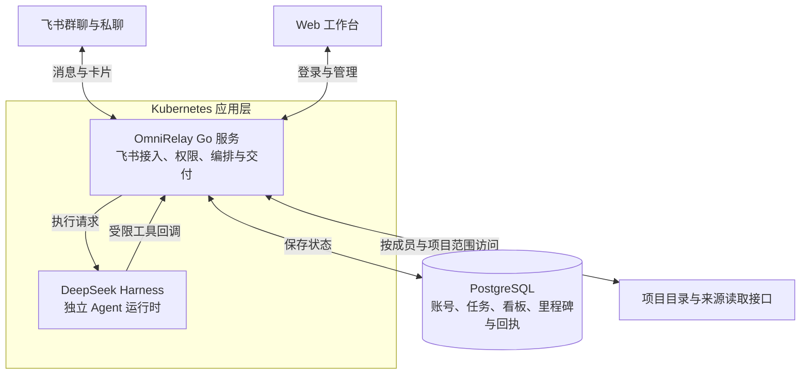
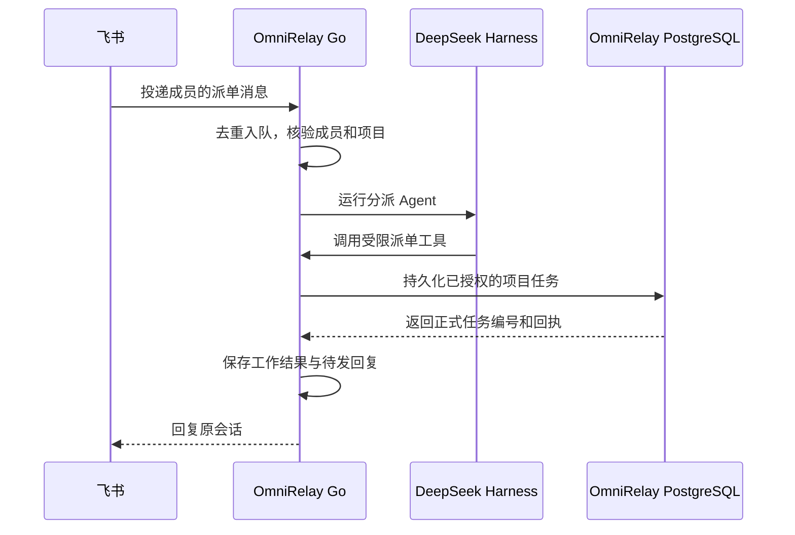

# OmniRelay


**群里问进度，群里交办任务，关键变化每天汇总。**

OmniRelay 是面向 **500 人以内单飞书组织**的项目助手，采用自托管架构。成员在群里 @ Bot 或发起私聊，就能查询项目任务、交办事项、查看当前风险。

**工作台已实现账号登录、用户管理、系统级角色与飞书通讯录。** 项目协作和 Bot 卡片可继续使用离线原型体验。


## 产品特性

- **一句话查进度。** 在飞书问「今天还有哪些任务卡住了？」，查看任务状态、负责人、截止时间和来源。群内回复遵循该群的公开范围。
- **交办后有回执。** 在原会话里把任务分给同项目成员。正式写入成功后返回任务编号，发送结果单独记录，方便核对。
- **每天只看项目重点。** 群简报汇总重要任务、风险和关键变更，支持预览后按项目定时发布。
- **权限和运行状态看得见。** 工作台集中呈现飞书登录、组织同步、项目角色、运行记录和审计。Agent 工具调用按工作授权约束。

项目群与私聊 Agent 的独立运行镜像、定向提醒接口和五项内部验收门槛见 [DSH Runtime](runtime/dsh/README.md)。

开发、评审与合并统一遵循[工程实现与合并标准](AGENTS.md#工程实现与合并标准)。

## 体验原型

下载项目后，保留 `design/prototype/` 的目录结构，在浏览器打开以下文件。演示使用本地数据，体验时无需飞书凭据或后端服务。

- [工作台](design/prototype/omni-relay-workbench.html) · 查看项目、任务、运行记录和系统管理。
- [飞书登录演示](design/prototype/omni-relay-workbench.html#/login) · 体验模拟授权流程。
- [飞书 Bot 卡片](design/prototype/omni-relay-feishu-prototype.html) · 试用任务查询、任务分派和项目简报三种交互。
- [色彩系统](design/prototype/omni-relay-color-system.html) · 查看浅色、深色主题及设计色值。

## 在个人 Harness 中使用 OmniRelay CLI

在工作台头像菜单为自己的账号创建个人 API Key。在仓库根目录运行 `go build -o bin/omnirelaycli ./cmd/omnirelaycli`，把生成的可执行文件放到个人 Harness 可以调用的命令路径。通过该 Harness 的环境配置指定 `OMNIRELAY_URL`（OmniRelay 的 HTTPS 站点根地址），通过凭据配置注入 `OMNIRELAY_API_KEY`。允许 Harness 调用这个命令即可，无需注册 Agent 或连接 DSH Runtime。

```sh
omnirelaycli whoami
omnirelaycli projects
omnirelaycli project "$PROJECT_ID"
omnirelaycli pm ask "$PROJECT_ID" "$REQUEST_ID" "我今天的项目日报是什么？"
omnirelaycli pm messages "$PROJECT_ID"
```

从项目目录选取一个项目，将其 ID 设为 `PROJECT_ID`。目录默认显示第一页，可以用 `omnirelaycli projects 2` 翻页。发送问题前为 `REQUEST_ID` 生成一个 8–96 位的唯一标识，只使用英文字母、数字、下划线或连字符。中断后重试同一问题时复用该标识。成功提交会返回工作 ID，在本人的项目消息中按该 ID 读取状态和 PM 回复。命令用标准输出返回 JSON，失败时以非零状态退出并写入标准错误。

服务端逐请求校验密钥所有者的账号、会籍和资源权限。个人工具向 PM 提问时，发起人是该用户，回答仍使用项目 PM 的名字和空间署名。用户可以在工作台独立撤销为某个 Harness 签发的密钥。

## 运行工作台

工作台由 Go 服务同源提供。准备支持 TLS 的 PostgreSQL 和飞书自建应用，参照[环境变量模板](config/backend.env.example)向服务注入凭据。将 HTTPS 入口设置为 `OMNIRELAY_PUBLIC_ORIGIN`，并在飞书应用内登记该地址下的 `/auth/feishu/callback`。首次启动需要本应用下首位管理员的飞书 Open ID。

使用账号密码登录时，设置 `OMNIRELAY_TLS_CERT_FILE` 和 `OMNIRELAY_TLS_KEY_FILE`，让 Go 监听 HTTPS。若经 Kubernetes Ingress 访问，入口到 Go 服务的连接也需使用 TLS，并验证上游证书。只在入口终止 TLS 的部署仍可提供飞书登录。避免在入口访问日志及 APM 中采集 `/auth/` 请求体或登录回调查询参数。

```sh
npm ci
npm run build
mkdir -p bin
go build -o bin/omnirelay ./cmd/omnirelay
./bin/omnirelay migrate
./bin/omnirelay serve
```

同步通讯录后，管理员可在「系统管理 → 用户管理」开通目录人员。账号密码登录需要运维为现有有效账号单独设置密码。命令从终端无回显地读取至少 15 个字符且最多 256 字节的密码，设置或重置密码会撤销该账号的现有会话。

```sh
./bin/omnirelay password <account-id> <username>
```

已开通且启用的账号自动拥有普通用户角色，可登录并维护本人资料。系统管理员可管理账号、系统角色和 Bot 配置，并执行目录同步和连接检测。系统运维者可查看用户管理、角色权限、审计日志与 Bot 配置，并执行目录同步和连接检测。审计查看者可查看审计日志。多角色权限取并集，系统角色按租户和应用隔离。

系统角色授权、撤销和用户启停经服务端鉴权并写入审计。项目目录、正式成员、任务与日报由 OmniRelay 的 PostgreSQL 管理。项目级权限由当前有效的成员关系、业务动作和委派代次决定。飞书群聊、分享资料和发信仍须通过飞书来源与群权限核验。接口字段见[权限能力协议](design/engineering/feishu-integration-contract.md#系统角色与权限能力)。

## 使用个人 API Key 远程调试

在工作台打开用户头像 → **个人 API Key**，输入用途名称后创建。请在关闭窗口前将密钥存入自己的密钥管理器。每把密钥有效期 30 天，可在同一入口提前撤销。每个账号可以同时持有 10 把有效密钥。

在 Bash 中设置工作台的 HTTPS 地址，隐藏输入密钥后查询当前身份。

```bash
OMNI_URL='https://你的工作台域名'
read -rsp 'OmniRelay API Key: ' OMNI_API_KEY && echo
curl --fail-with-body -H "Authorization: Bearer $OMNI_API_KEY" "$OMNI_URL/api/v1/me"
```

在启用 Runtime 的工作台，把 `PROJECT_ID` 换成自己已加入的项目 ID。发送返回 HTTP 202 和工作 ID，随后 GET 同一地址可读取自己的问答历史。网络中断时重试同一条消息应复用原来的 `REQUEST_ID`。

```bash
PROJECT_ID='项目ID'
REQUEST_ID=$(uuidgen)
BOT_URL="$OMNI_URL/api/v1/projects/$PROJECT_ID/bot/messages"
curl --fail-with-body -H "Authorization: Bearer $OMNI_API_KEY" \
  -H "Idempotency-Key: $REQUEST_ID" -H 'Content-Type: application/json' \
  -d '{"text":"我是谁？我在哪个项目？"}' "$BOT_URL"
curl --fail-with-body -H "Authorization: Bearer $OMNI_API_KEY" "$BOT_URL"
unset OMNI_API_KEY
```

个人密钥使用所属账号的当前业务权限。账号停用会撤销其全部密钥，移出项目后该项目接口随即拒绝访问。创建与撤销密钥在已登录工作台中完成。

## React 工作台开发与构建

在仓库根目录使用 Node.js 22.12 或更高版本和 `go.mod` 指定的 Go 工具链。干净检出的构建顺序如下。

```sh
npm ci
npm run typecheck
npm run build
go test ./...
go build -o bin/omnirelay ./cmd/omnirelay
```

`npm run dev` 启动带 React 快速刷新的 Vite。打开 `/` 或 `/setup`，可通过 `OMNIRELAY_DEV_ORIGIN` 指向已有 Go 后端，默认上游为 `http://127.0.0.1:8080`。生产构建输出到 `internal/webui/dist`。使用已有服务配置运行 `OMNIRELAY_PREVIEW_DIR="$PWD/internal/webui/dist" ./bin/omnirelay serve` 即可同源验证。镜像内对应目录为 `/opt/omnirelay/ui`。变量未设置时，Go 从二进制提供 React 工作台、首次配置页面和哈希资源。修改前端后先运行 `npm run build`，再重新构建 Go 二进制。预发布升级和恢复步骤见 [Kubernetes 部署说明](deploy/k8s/README.md#工作台升级与恢复)。

已配置的 Go 服务在 `/` 提供工作台；首次配置模式将 `/` 重定向到 `/setup`，OAuth 回跳 `/?setup=complete` 也使用初始化入口。两个入口均从 `/assets/` 加载带哈希资源。

浏览器验证使用已安装的 Chrome，将 `OMNIRELAY_CHROME` 设为其可执行文件。以下两条命令分别验证构建目录和 Go 的两种路由模式。

```sh
OMNIRELAY_BROWSER_DIST=internal/webui/dist node --test tests/integration/preview_browser.test.mjs
OMNIRELAY_PLAYWRIGHT_MODULE=playwright-core go test ./cmd/omnirelay -run '^TestPreviewUI$' -count=1
```

旧套件的 mock API 仍可独立运行。默认静态资源取自构建输出 `internal/webui/dist`；设置 `OMNIRELAY_ASSET_ORIGIN` 可以从指定 Go 服务读取静态资源，同时保留 mock API。原型对照使用独立的 `/prototype/` 路径或原型文件。真实后端用例沿用各 Go 测试创建的服务、账号和 PostgreSQL 夹具。

## 系统架构

### 整体拓扑



### 从飞书交办到正式任务



[模块设计](design/specs/omni-relay-module-design.md) · [Go 服务设计](design/specs/omni-relay-go-service-design.md) · [Kubernetes 部署设计](design/specs/omni-relay-k8s-deployment-design.md) · [UI 规范](design/specs/omni-relay-ui-standards.md)

## 项目目录

```text
design/                可体验原型、架构设计和 UI 规范
cmd/omnirelay/         Go 服务入口
internal/              Go 业务、接入和存储模块
frontend/              React 工作台与首次配置页面
internal/webui/        Go 静态资源服务与嵌入式前端构建产物
runtime/dsh/           DSH 运行配置与工具桥
migrations/            PostgreSQL 迁移
config/                配置模板
deploy/k8s/            Kubernetes 部署
tests/                 契约测试、集成测试和样例
```

[原型与设计索引](design/README.md)汇总可体验页面和设计资料。

## 参与讨论

欢迎分享团队在飞书中查进度、派任务和发简报的实际流程，也欢迎对原型、权限模型和业务接口提出反馈。

## 开源项目与致谢

**DeepSeek** 为 OmniRelay 的 Agent 运行与编排设计提供了两个重要参考。

| 项目标识 | 项目仓库 | 在 OmniRelay 中的用途 |
| :---: | --- | --- |
| [官方原图](https://github.com/deepseek-ai/DeepSeek-LLM/blob/main/images/logo.svg) | [DeepSeek Harness](https://github.com/deepseek-ai/deepseek-harness) | 架构采用的独立 Agent 运行时 |
| [官方原图](https://github.com/deepseek-ai/DeepSeek-LLM/blob/main/images/logo.svg) | [DeepSeek SuperAgent 研究原型](https://github.com/deepseek-ai/dsh-superagent-prototype) | 工作编排、授权与执行恢复的设计参考 |
| <a href="https://github.com/larksuite"></a> | [飞书 Go SDK](https://github.com/larksuite/oapi-sdk-go) | 飞书消息与 Bot 接入的 SDK 选型 |
| <a href="https://www.postgresql.org/media/img/about/press/elephant.png"></a> | [PostgreSQL 源码镜像](https://github.com/postgres/postgres) | 工作队列和运行账本的数据库选型 |
| <a href="https://github.com/cncf/artwork/tree/main/projects/kubernetes"></a> | [Kubernetes](https://github.com/kubernetes/kubernetes) | 部署架构所用的容器编排平台 |

[DeepSeek 品牌素材使用指引](https://github.com/deepseek-ai/awesome-deepseek-integration/blob/main/docs/_logo%20svg/guidelines.md)

当前原型带有 [Quill](https://github.com/slab/quill)、[markdown-it](https://github.com/markdown-it/markdown-it) 和 [highlight.js](https://github.com/highlightjs/highlight.js) 的浏览器分发文件。

<a href="https://github.com/slab/quill"></a>

## 许可证

OmniRelay 采用 [MIT License](LICENSE)。原型附带的第三方代码保留各自的许可证。 [第三方许可证与来源](THIRD_PARTY_NOTICES.md)
