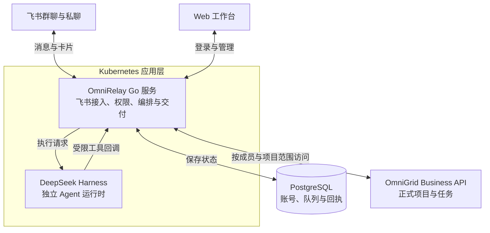
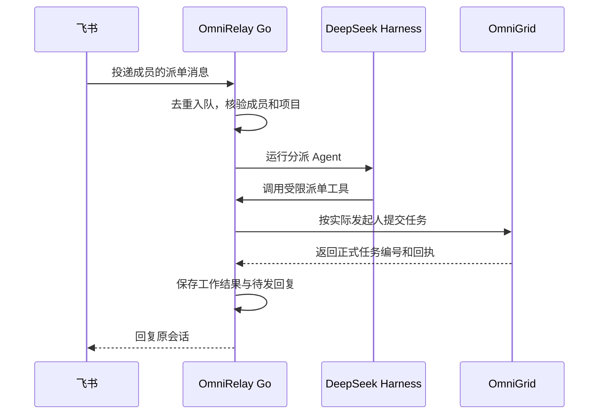

# OmniRelay


**群里问进度，群里交办任务，关键变化每天汇总。**

OmniRelay 是面向 **500 人以内单飞书组织**的项目助手，采用自托管架构。成员在群里 @ Bot 或发起私聊，就能查询项目任务、交办事项、查看当前风险。

仓库提供可离线体验的工作台和 Bot 卡片原型，以及支持飞书登录、用户与角色管理、组织目录同步的 Go 后端。


## 产品特性

- **一句话查进度。** 在飞书问「今天还有哪些任务卡住了？」，查看任务状态、负责人、截止时间和来源。群内回复遵循该群的公开范围。
- **交办后有回执。** 在原会话里把任务分给同项目成员。正式写入成功后返回任务编号，发送结果单独记录，方便核对。
- **每天只看项目重点。** 群简报汇总重要任务、风险和关键变更，支持预览后按项目定时发布。
- **权限和运行状态看得见。** 工作台集中呈现飞书登录、组织同步、项目角色、运行记录和审计。Agent 工具调用按工作授权约束。

## 体验原型

下载项目后，保留 `design/prototype/` 的目录结构，在浏览器打开以下文件。演示使用本地数据，体验时无需飞书凭据或后端服务。

- [工作台](design/prototype/omni-relay-workbench.html) · 查看项目、任务、运行记录和系统管理。
- [飞书登录演示](design/prototype/omni-relay-workbench.html#/login) · 体验模拟授权流程。
- [飞书 Bot 卡片](design/prototype/omni-relay-feishu-prototype.html) · 试用任务查询、任务分派和项目简报三种交互。
- [色彩系统](design/prototype/omni-relay-color-system.html) · 查看浅色、深色主题及设计色值。

## 运行后端

飞书登录使用服务端会话，账号开通和授权变更可审计。组织目录按飞书应用授权范围同步。构建、配置和接口说明见 [后端运行说明](docs/backend.md)。

## 系统架构

### 整体拓扑



### 从飞书交办到正式任务



[模块设计](design/specs/omni-relay-module-design.md) · [Go 服务设计](design/specs/omni-relay-go-service-design.md) · [Kubernetes 部署设计](design/specs/omni-relay-k8s-deployment-design.md) · [UI 规范](design/specs/omni-relay-ui-standards.md)

## 项目目录

```text
design/                可体验原型、架构设计和 UI 规范
cmd/omnirelay/         Go 服务入口
internal/              Go 业务、接入和存储模块
web/                   正式工作台
runtime/dsh/           DSH 运行配置与工具桥
migrations/            PostgreSQL 迁移
config/                配置模板
deploy/k8s/            Kubernetes 部署
tests/                 契约测试、集成测试和样例
```

[原型与设计索引](design/README.md)汇总可体验页面和设计资料。

## 参与讨论

欢迎分享团队在飞书中查进度、派任务和发简报的实际流程，也欢迎对原型、权限模型和业务接口提出反馈。

## 开源项目与致谢

**DeepSeek** 为 OmniRelay 的 Agent 运行与编排设计提供了两个重要参考。

| 项目标识 | 项目仓库 | 在 OmniRelay 中的用途 |
| :---: | --- | --- |
| [官方原图](https://github.com/deepseek-ai/DeepSeek-LLM/blob/main/images/logo.svg) | [DeepSeek Harness](https://github.com/deepseek-ai/deepseek-harness) | 架构采用的独立 Agent 运行时 |
| [官方原图](https://github.com/deepseek-ai/DeepSeek-LLM/blob/main/images/logo.svg) | [DeepSeek SuperAgent 研究原型](https://github.com/deepseek-ai/dsh-superagent-prototype) | 工作编排、授权与执行恢复的设计参考 |
| <a href="https://github.com/larksuite"></a> | [飞书 Go SDK](https://github.com/larksuite/oapi-sdk-go) | 飞书消息与 Bot 接入的 SDK 选型 |
| <a href="https://www.postgresql.org/media/img/about/press/elephant.png"></a> | [PostgreSQL 源码镜像](https://github.com/postgres/postgres) | 工作队列和运行账本的数据库选型 |
| <a href="https://github.com/cncf/artwork/tree/main/projects/kubernetes"></a> | [Kubernetes](https://github.com/kubernetes/kubernetes) | 部署架构所用的容器编排平台 |

[DeepSeek 品牌素材使用指引](https://github.com/deepseek-ai/awesome-deepseek-integration/blob/main/docs/_logo%20svg/guidelines.md)

当前原型带有 [Quill](https://github.com/slab/quill)、[markdown-it](https://github.com/markdown-it/markdown-it) 和 [highlight.js](https://github.com/highlightjs/highlight.js) 的浏览器分发文件。

<a href="https://github.com/slab/quill"></a>

## 许可证

OmniRelay 采用 [MIT License](LICENSE)。原型附带的第三方代码保留各自的许可证。 [第三方许可证与来源](THIRD_PARTY_NOTICES.md)
