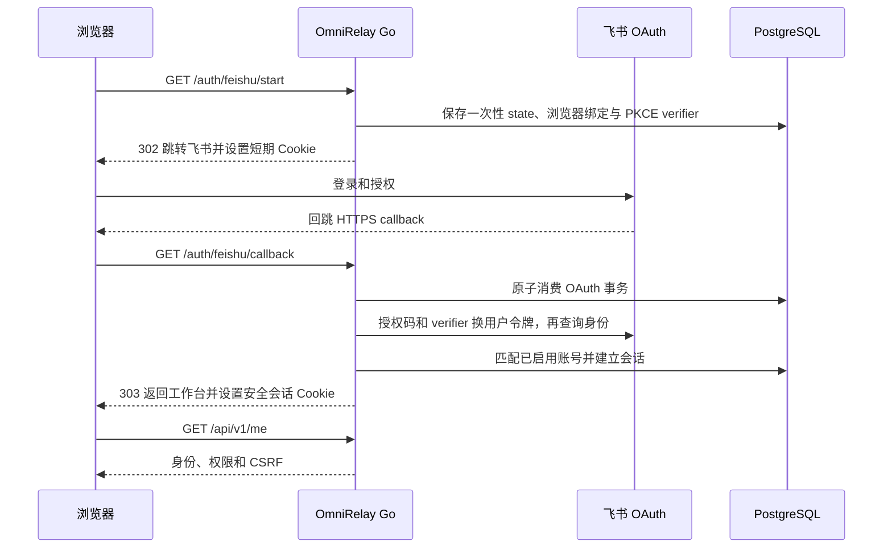

# 飞书 Bot 配置、登录与通讯录同步

## 1. 范围与现状

单个部署连接一个飞书组织和一个企业自建应用。Bot、网页登录、组织与人员同步共用 `tenant_key` 和 `app_id`。人的飞书身份用 `(tenant_key, app_id, open_id)` 解析到现有 OmniRelay 账号。系统管理员明确开通账号，通讯录同步只更新目录。Bot 自身的 `open_id` 用于识别群消息里的 @ 对象。

| 功能 | 当前工作区 | 本次拆解 |
| --- | --- | --- |
| 系统管理 → 飞书 Bot 配置 | 系统菜单有用户、角色、审计。设计稿已有长连接和选主约定 | 新增配置页、脱敏状态、启停、连接检测、长连接收消息 |
| 飞书登录 | 工作台入口已对接 Go OAuth 接口。Go 已有 PKCE、账号校验和服务端会话 | 补齐错误返回和原页面恢复，联调真实飞书应用及账号准入 |
| 同步组织和人员 | Go 已有通讯录分页、任务和快照接口。用户管理已消费目录与同步接口 | 验收真实授权范围、组织树、多部门人员、同步状态和失败恢复 |

App ID、Tenant Key、App Secret 和公开地址由部署配置注入。管理页展示应用标识和凭据是否已注入，保存项为 Bot 入口启停。凭据轮换由部署流程处理。更换 App ID 或组织涉及现有账号、目录以及群绑定的迁移，使用独立操作流程。

## 2. 公共权限与接口约定

已开通且启用的账号自动拥有普通用户角色 `system_user`，包括系统角色上线前已存在的账号。角色目录将其标识为默认角色。角色页按有效启用账号统计人数，授权记录只保存手动授权。停用账号失去有效系统角色及会话，重新启用后恢复默认角色和仍有效的手动授权。

系统管理员可管理账号、系统角色和配置。系统运维者可查看用户、角色、审计及 Bot，可发起通讯录同步和 Bot 检测。审计查看者的系统管理入口仅包含审计。系统角色可以叠加，操作权限按并集计算，最后一位启用的系统管理员受停用和撤权保护。

侧栏、移动导航和直达路由以 `GET /api/v1/me` 的能力为准。登录后优先返回有权访问的站内目标，其余情况进入默认落点。系统运维者在正式项目权限源确认可访问项目时也显示工作台。项目读写和委派继续按正式成员关系、业务能力和当前成员代次独立鉴权。项目权限源不可用时拒绝项目操作。见[系统角色与权限能力协议](../engineering/feishu-integration-contract.md#系统角色与权限能力)。

- `GET /api/v1/me` 的 `access.admin.feishu_bot` 控制菜单显示。系统管理员和系统运维者可通过 `system.read` 查看 Bot 状态，通过 `system.operate` 提交检测。配置变更和启停要求 `system.configure`，由系统管理员执行。目录查看与同步分别使用 `directory.read` 和 `directory.sync`，两类角色均可执行。接口每次重新鉴权。
- 管理接口使用同源会话 Cookie。写操作同时校验 `Origin` 与 `X-CSRF-Token`。会话无效返回 401，权限或 CSRF 不足返回 403。新增接口的业务错误形如 `{"error":"config_version_conflict"}`。页面只显示本地化的错误提示。
- 进入飞书 API 的地址来自服务端适配器。App Secret、飞书访问令牌、OAuth code 和会话 Cookie 不出现在接口响应、日志、审计、APM 请求采集和前端存储。管理诊断保留请求 ID、飞书请求 ID 和映射后的错误码即可。
- 三条链路独立显示状态。Bot 暂停或重连时，OAuth 和目录同步可以继续。租户密钥轮换后，分别验证换码、Bot 重连和目录读取。只采集各链路必要的飞书权限，应用可用范围也须单独核对。 [飞书应用鉴权](https://open.feishu.cn/document/home/introduction-to-scope-and-authorization/overview)

## 3. Bot 配置协议

### 工作台

新增 `#/system/feishu-bot`，同步接入侧栏、移动端选择器和直达路由。页面包括应用信息、Bot 开关和诊断区。应用信息显示只读 App ID、租户标识、凭据是否已注入、Bot 名称及 OAuth 回调地址。管理员修改开关后点「保存」。具备 `system.operate` 的账号可使用「测试连接」。测试使用部署中的凭据，并保留当前编辑内容。离开页面时复用工作台未保存提示。

诊断区分别显示凭据校验、Bot 信息可读、长连接状态和最近一条合规消息的接收时间。凭据有效即可显示凭据校验通过。长连接在线须来自当前持有者的有效心跳。消息已接收须来自当前连接代次成功提交的真实事件。若尚未收到消息，提示在预发布测试群 @ Bot 或与 Bot 私聊。检测动作本身只读飞书接口，不发消息。

### 工作台到 Go

| 请求 | 请求参数与响应 | 约束 |
| --- | --- | --- |
| `GET /api/v1/system/feishu-bot` | 返回脱敏配置与运行状态，设置 `ETag: "bot-<version>"` | 有读取权限。读取存储状态，页面轮询不调用飞书 |
| `PATCH /api/v1/system/feishu-bot` | `{"enabled":true}`，带 `If-Match`。成功返回 200、新配置和 ETag | 管理员专用。缺少版本返回 428，版本不匹配返回 412，未识别字段返回 400。同事务写开关版本与审计。相同值不产生新变更 |
| `POST /api/v1/system/feishu-bot/checks` | 空 JSON，带 `Idempotency-Key`。返回 202 与 `{"id":"...","state":"queued","reused":false}` | 同一应用同一凭据代次复用进行中的检测。用户重试同一个键时返回同一任务。检测不改变配置和连接所有权 |
| `GET /api/v1/system/feishu-bot/checks/{id}` | 返回 `state`、阶段结果、时间戳和脱敏错误码 | 状态为 `queued/running/succeeded/failed`。越界及不存在均返回 404，前端只在任务进行时轮询 |

配置读取示例。初始版本为 0，初始开关为关闭。时间字段采用 UTC RFC 3339。

```json
{
  "app_id": "cli_example",
  "tenant_key": "tenant_example",
  "credentials_configured": true,
  "bot_name": "OmniRelay",
  "oauth_callback_url": "https://relay.example.com/auth/feishu/callback",
  "enabled": true,
  "version": 3,
  "connection": {
    "state": "connected",
    "last_heartbeat_at": "2026-11-18T08:22:00Z",
    "last_message_at": null
  }
}
```

- 连接状态为 `disabled/connecting/connected/reconnecting/unavailable`。每个状态关联配置版本和连接代次。健康状态过期时返回 `unavailable`。空的 `last_message_at` 表示本次连接尚未验证收信。
- 检测项格式为 `{"name":"bot_info","state":"passed","checked_at":"..."}`。`name` 可为 `tenant_token/bot_info`，`state` 可为 `passed/failed/skipped`。连接与收信结果使用配置查询返回的独立状态。常见错误码为 `credentials_missing`、`credentials_rejected`、`bot_unavailable` 和 `provider_temporarily_unavailable`。过期凭据代次的检测结果保留历史，当前状态不被旧任务覆盖。
- PostgreSQL 按组织和应用保存配置版本、当前连接代次和最近在线状态，另存检测任务与结果。检测任务对同源活动任务加唯一约束，写入、领取和提交都校验凭据代次，异常退出后按租约回收。凭据代次使用部署提供的非敏感版本号。保存只提交期望状态，连接调整由持有者协调。

### Go 到飞书

预发布应用启用机器人能力和网页能力，设置应用可用范围。收群 @ 使用 `im:message.group_at_msg:readonly`，收私聊使用 `im:message.p2p_msg:readonly`。通讯录使用应用身份读取权限 `contact:contact:readonly_as_app`，并单独设置可读部门和人员范围。准备一个同组织测试群、一名已开通成员和一名未开通成员。 [飞书消息权限](https://open.feishu.cn/document/uAjLw4CM/ukTMukTMukTM/reference/im-v1/guide/faq) · [飞书通讯录应用权限](https://open.feishu.cn/solutions/detail/leave_connector?lang=zh-CN)

1. **凭据与 Bot 信息检测。** Go 使用 `client_credentials` 换租户令牌，再使用该令牌读取 `GET /open-apis/bot/v3/info`，拿到 Bot 名称及自身 `open_id`。检测独立于网页登录。 [自建应用租户令牌](https://open.feishu.cn/document/uAjLw4CM/ukTMukTMukTM/authentication-management/access-token/tenant_access_token) · [获取机器人信息](https://open.larkenterprise.com/document/client-docs/bot-v3/obtain-bot-info)
2. **连接。** 持有 Kubernetes Lease 的实例读取最新开关和应用凭据，使用官方 Go SDK 建立向飞书发起的 WebSocket。首启时先让测试实例连上，再到飞书开发者后台保存长连接方式并发布消息订阅。失去 Lease 或关闭开关时，当前实例停收，事务拒绝旧代次的事件。SDK 启停、在线状态信号、处理超时与重投行为用拟选 SDK 版本做实测。 [飞书长连接文档](https://open.feishu.cn/document/ukTMukTMukTM/uYDNxYjL2QTM24iN0EjN/event-subscription-configure-)
3. **收消息。** 订阅 `im.message.receive_v1`，验证事件来源应用和组织，接受用户私聊及明确 @ 当前 Bot 的群消息，滤掉机器人成员和无关消息。转换为现有设计的 `InboundEvent`，身份解析复用 `(tenant_key, app_id, sender_open_id)`。按照 `(app_id, tenant_id, message_id)` 在 PostgreSQL 去重，事件和待路由工作同事务写入，事务提交后再确认受理。飞书要求长连接事件在 3 秒内处理，回调内只做校验和受理。已有事件直接返回原受理结果。 [接收消息事件](https://open.feishu.cn/document/server-docs/im-v1/message/events/receive) · [Go 入站契约](omni-relay-go-service-design.md#21-入站契约)

## 4. 飞书网页登录协议



| 接口 | 保持与补齐 |
| --- | --- |
| `GET /auth/feishu/start?return_to=%2F%23%2Fworkbench` | 复用现有接口。浏览器整页导航。Go 对返回目标限定工作台内部路由，添加 Bot 配置页后同步更新前端路由白名单。 |
| `GET /auth/feishu/callback` | 保留现有地址。无效、过期或重复的 state 统一返回 400。已验证的事务在用户取消、账号不可登录或飞书暂不可用时，303 返回 `/#/login?error=<code>`，其中 `code` 为 `cancelled/denied/unavailable`。前端保留对旧 `error=feishu` 的兼容。 |
| `GET /api/v1/me` | 前端通过它确认会话成立并取得角色和 CSRF。回跳路由的权限仍逐请求核验。 |
| `POST /auth/logout` | 使用现有同源 CSRF 机制，撤销当前会话后返回 204，页面回到登录页。 |

`state` 与发起浏览器绑定，一次性消费。Go 通过 PKCE S256 换取飞书用户令牌，仅用于本次身份查询。应用由换码请求绑定，租户和 Open ID 来自飞书返回的身份。只有匹配到已开通且启用的本地账号才发会话。注册 OAuth 回调时使用完整 HTTPS 地址，OAuth 回调 URL 的查询参数在入口日志里丢弃。真实飞书验收覆盖发起、取消、回跳、未开通和已停用账号、异组织、回调重放、退出。 [飞书网页授权流程](https://open.feishu.cn/document/client-docs/build-login-free-system-) · [飞书 PKCE 参数](https://open.feishu.cn/document/uAjLw4CM/uYjL24iN/mobile-app)

## 5. 同步飞书组织和人员

### 工作台到 Go

复用「系统管理 → 用户管理」里的组织树、「同步」和「同步详情」。Bot 配置页可以放一个「查看组织同步」入口，进入已有页面。各接口基址为 `/api/v1/system/directory`。

| 请求 | 参数与结果 |
| --- | --- |
| `GET /departments` | 按 `parent_id` 加载直接下级，省略表示根。用 `limit/offset` 分页。 |
| `GET /people` | 支持 `department_id`、`include_descendants`、姓名检索 `q`、账号状态 `account_status` 和分页。人员按 Open ID 去重，返回全部有权查看的部门路径。 |
| `POST /sync-runs` | 同源、CSRF、目录同步权限。202 返回任务 ID、当前状态及 `coalesced`。已存在同步任务时复用同一 ID，每次有权的手动请求进入审计。 |
| `GET /sync-runs` 或 `GET /sync-runs/{syncID}` | 查询历史或单次运行的 `queued/running/succeeded/failed` 状态、开始与结束时间、范围、人数、部门数、变更数和失败原因。列表同时提供最近成功时间和下次同步时间。 |

部门树和人员列表使用同一 `snapshot_version`，换页传回该值，遇到 `409 directory_snapshot_changed` 时重新加载。刷新成功时尽量保留当前部门和筛选，部门已不可见时回到根。同步进行中继续显示仍获授权的上次快照。同步成功后再刷新目录。状态区分初次无快照、已有可见快照、本轮失败和授权范围已变化。目录状态与本地账号状态单独展示，人员可处于「尚未开通」。开通继续调用现有 `POST /api/v1/system/accounts`。

### Go 到飞书

1. 启动检查、周期到点或管理员手动触发进入同一任务队列。同源只允许一个活动任务。PostgreSQL 租约和领取版本保护发布，进程重启后按既有退避恢复。
2. 用应用身份获取租户令牌，先读取 `GET /open-apis/contact/v3/scopes`。按授权内的部门读取子部门和直属人员，补取直接授权给应用的个人。明确核对按人授权和在职状态字段所需的权限。同一人员可归属多个部门。飞书没提供在职状态时记为未知。 [授权范围](https://open.feishu.cn/document/server-docs/contact-v3/scope/list) · [子部门](https://open.feishu.cn/document/server-docs/contact-v3/department/children) · [直属人员](https://open.feishu.cn/document/server-docs/contact-v3/user/find_by_department)
3. 读取全部分页，检查 ID、父子关系、重复分页和人员归属。发布前再次读授权范围并比对。源站返回不完整分页、超时或限流耗尽时记录失败。同一授权范围仍保留上一份快照。确认授权收窄或权限撤回时先隐藏旧目录，再等完整替换。发布事务同时提交经过验证的新快照及对应的账号回收。
4. 首次成功同步建立在册基线。按租户、应用和 Open ID 核对历史在册人员。授权变化的批次更新基线和可见快照。授权摘要稳定时，用飞书单人查询核对完整目录中消失的人员，避免分页期间调岗造成漏读。部分授权下，只有明确的用户不存在结果可确认离职。整组织范围下，消失后单人查询明确返回离职也可确认。 [单人查询](https://open.feishu.cn/document/server-docs/contact-v3/user/get) · [飞书通用错误码](https://open.feishu.cn/document/server-docs/api-call-guide/generic-error-code)
5. 同一个发布事务记录离职时间和同步批次，对已开通账号执行停用、递增权限版本、删除所有会话并写系统审计。飞书 OAuth、密码登录及旧会话均受本地停用状态约束。同步仍需显式开通账号和授予角色。
6. 最后一位启用的系统管理员离职时保留启用状态，用户详情与审计显示停用保护。转交管理员权限后，可手动停用或等下次成功同步回收。重新同步到在册人员时，目录恢复显示当前状态和可见组织路径，管理员可显式启用此前停用的账号。

## 6. 前后端任务和交付顺序

| 任务 | 范围 | 主要交付 | 完成标准 |
| --- | --- | --- | --- |
| 后端 1 · Bot 配置与检测 | `internal/system`、`migrations`、`internal/access/access.go`、`cmd/omnirelay/server.go` | 实现 §3 管理接口、检测记录、权限和配置审计 | 普通用户禁止访问，运维不可改开关，旧版本保存失败，重复检测只跑一次，响应和日志无凭据 |
| 后端 2 · Bot 长连接 | `internal/feishu`、`cmd/omnirelay`、入站存储与工作受理模块 | 接入官方 SDK、Lease、连接状态、来源校验、持久化和去重 | 同一消息只入库一次。旧持有者不能提交。真实私聊和群 @ 到达，长连接掉线可恢复 |
| 后端 3 · 飞书登录联调 | `internal/identity`、`cmd/omnirelay/backend_test.go` | 保留 OAuth 接口，完善固定错误回跳、允许路径及可观测错误 | 真实账号成功回跳，未开通与停用账号拒绝登录，重复回调无新会话，退出后会话失效 |
| 后端 4 · 组织同步联调 | `internal/directory`、现有目录与账号测试 | 核对权限范围、人员字段和失败分类，用真实飞书测试组织验证现有同步 | 多部门人员去重、调岗体现新路径、并发同步复用任务、缺页保留可见快照、撤权后旧目录不可读 |
| 前端 1 · Bot 配置 | `web/index.html`、`web/app.js`、`web/system-api.js`，新增独立 Bot 页面模块 | 菜单、路由、配置和检测 UI，复用会话、权限和反馈组件 | 保存与测试互不影响。连接在线与消息已接收分别显示。运维只见授权操作。过期版本刷新后保留待编辑内容 |
| 前端 2 · 飞书登录 | `web/login.js`、`web/app.js` | 对接回跳枚举、回跳路由和会话恢复 | 取消可再次登录，失败提示可操作。成功回到原先有权的页面。权限变化时回到工作台或显示无权状态 |
| 前端 3 · 组织与人员 | `web/admin.js`、`web/system-api.js` | 复用组织筛选和同步抽屉，补齐范围、陈旧数据、正在同步和失败展示 | 同名人员可按部门区分，缺页失败仍可浏览上次快照，撤权后及时清除页面中的旧条目，新增人员可显式开通 |

先固定上述字段、枚举和示例。前端可基于接口样例做 UI，后端可并行实现 Bot、登录和目录。联调顺序为 **预发布自建应用和凭据 → 管理页读取及连接检测 → OAuth 真机登录 → 授权范围内的目录同步 → 预发布测试群 @ Bot 入站**。最后在同一次验收里验证 Bot 停用后 OAuth 和目录仍可用，以及同一成员通过网页和 Bot 解析到同一个账号。应用权限、真实事件订阅和 OAuth 回调登记需要实际预发布应用验证。
