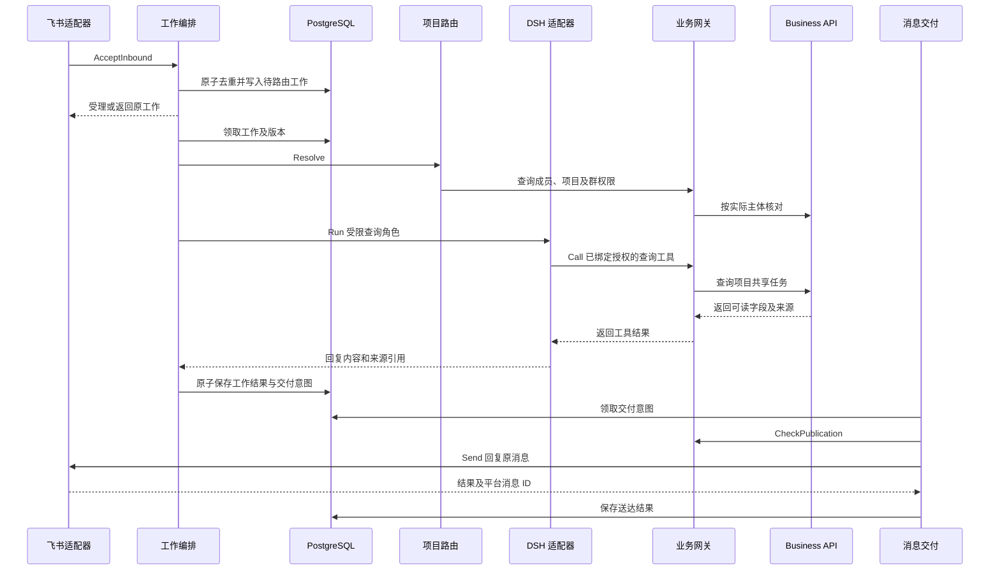

# OmniRelay Go 主服务详细设计

2026-11-18 · v0.5 架构评审稿

基于 [OmniRelay 模块设计 v0.3](omni-relay-module-design.md#1-服务部署边界)。Go 主服务在 Kubernetes 以模块化 Deployment 运行，首期一个副本。PostgreSQL 持久化工作队列和运行账本。DSH 以独立 StatefulSet 和运行身份部署。正式任务、项目成员和重要性标记由 OmniGrid 的 Business API 持有。本文接口名用于 Go 代码边界评审，传输协议和版本在兼容验证后冻结。

## 1. 包结构与依赖方向

```text
cmd/omnirelay                 配置、依赖装配、启动与关闭
internal/
  feishu/                     长连接、事件校验与映射、发送适配
  identity/                   飞书授权登录、账号绑定、工作台会话
  directory/                  部门树、人员目录、通讯录快照与同步
  access/                     角色授权、资源范围、撤权与鉴权
  routing/                    可信身份、项目和话题解析
  orchestrator/               入站受理、阶段推进、租约、会话绑定与恢复
  agent/dsh/                  AgentRunner、DSH 执行协议与工具回调入口
  business/                   工作授权、类型化工具、业务回执
  business/omnigrid/          Business API 请求与响应适配
  briefing/                   计划、项目本地日期、简报生成与发布条件
  delivery/                   目标复核、出站发送与对账
  workbench/                  工作台 HTTP 读模型与运行详情投影
  system/                     组织与账号管理、项目接入配置、运营与审计查询
  store/postgres/             PostgreSQL 迁移、查询与原子状态变更
```

| 调用方 | 依赖 | 规则 |
| --- | --- | --- |
| `feishu` | 入站受理接口 | 校验来源应用、组织、事件类型和 Bot 是否被 @，映射成内部事件后仅等待本地落库 |
| `identity` | 飞书 OAuth、账号和会话存储 | 识别已验证的飞书主体，解析同一个本地账号，建立或撤销工作台会话 |
| `directory` | 飞书通讯录适配器、目录存储 | 同步授权范围内的部门与人员，提供部门树、人员检索和同步状态 |
| `access` | 账号状态、角色授权、项目成员关系 | 按动作和对象范围授权。工作台、路由和业务网关复用，Business API 继续校验正式业务操作 |
| `orchestrator` | `routing`、`AgentRunner`、工作存储、交付意图构造 | 推进工作阶段。外部调用在事务外进行。写入终态与创建结果消息使用同一事务 |
| `routing` | 身份目录、项目绑定及成员查询 | 周边数据缺失或歧义时产生明确结果，无权路由不能进入有业务工具的执行阶段 |
| `agent/dsh` | DSH 进程、`ToolHandler` | 编解码请求和执行结果。工具回调进入 Go 业务网关，与执行请求并行处理 |
| `business` | 授权读取、操作账本、`BusinessBackend` | 对工具调用做授权、输入校验、字段投影和回执核验。仅 `business/omnigrid` 持有业务连接细节 |
| `briefing` | 项目计划、定时入队接口 | 扫描到期计划、原子建立日运行与工作。分析沿用编排，自动标记经业务网关写入 |
| `delivery` | 交付账本、公开范围复核、`Sender` | 工作终态保存后独立领取交付。由 `feishu` 实现发送，飞书凭据留在通道适配器 |
| `workbench` | 授权查询、业务只读投影、运行查询 | 为现有原型提供项目、任务、简报和运行状态。按请求者权限和项目过滤 |
| `system` | `identity`、`directory`、`access`、运营查询、配置与审计存储 | 提供组织与用户管理、角色管理、项目群配置、简报计划、连接状态和审计查询 |
| `store/postgres` | 上述模块消费的存储契约 | 实现 PostgreSQL 事务和状态条件更新，SQL 留在存储适配层 |

接口定义放在调用方所在包。领域类型随拥有该概念的模块定义，依赖方向统一朝领域模块。下文 Go 签名省略跨包类型的包名前缀。飞书 SDK 类型、DSH 协议帧和 OmniGrid 请求结构分别收口在适配器内。通过 `cmd/omnirelay` 注入实现，可用同一个进程内的假适配器测试全链路。

| 类型所有者 | 主要类型与引用方向 |
| --- | --- |
| `orchestrator` | 定义 `InboundEvent`、`AcceptResult`、`WorkID`、`BriefingTrigger` 和 Agent 请求／结果。飞书适配器、DSH 适配器、简报模块引用这些类型 |
| `routing` | 定义 `RouteInput`、`RouteDecision`。编排从入站事件构造 `RouteInput`，路由模块可依赖业务只读类型 |
| `business` | 定义业务主体、授权、`VerifiedTurnBinding`、工具请求、业务回执和发布核验类型。DSH 适配器、编排和交付引用这些类型 |
| `delivery` | 定义 `DeliveryIntent`、`OutboundMessage`、`SendReceipt`。编排构造意图，飞书适配器实现发送接口 |

编排引用路由、业务和交付的契约。交付引用业务的范围核验契约，飞书适配器由装配层注入。身份模块通过飞书适配器完成 OAuth 换码和身份读取。权限模块通过注入的只读接口读取正式成员关系，业务网关把权限检查结果用于访问业务数据。简报模块向编排提交定时触发，编排按作业类型推进分析和保存预览。PostgreSQL 适配层实现各模块消费的存储接口。

## 2. 接入与路由

### 2.1 入站契约

```go
// feishu 包所依赖的受理接口，InboundEvent 和 AcceptResult 由编排模块定义。
type InboxAcceptor interface {
    AcceptInbound(ctx context.Context, event InboundEvent) (AcceptResult, error)
}

type InboundEvent struct {
    AppID, TenantID, EventID, MessageID string
    ChatID, ThreadID, SenderOpenID      string
    ChatKind                           ChatKind
    ReplyToMessageID                   string
    ReceivedAt                         time.Time
    Text                               string
}
```

入站唯一键为 `(app_id, tenant_id, message_id)`，平台事件 ID 用于追踪。受理事务同时保存事件及待路由工作。重复事件返回原 `work_id`，容量判断在去重之后执行。长连接回调只在事务提交后确认受理。存储不可用时返回临时失败，队列满的拒绝方式及平台重投行为用测试 Bot 验证。连接层确认只表示已受理。

### 2.2 路由契约

```go
type ProjectRouter interface {
    Resolve(ctx context.Context, input RouteInput) (RouteDecision, error)
}
```

`RouteDecision` 表达 `resolved`、`needs_clarification` 或 `denied`。可信身份使用应用、组织和飞书发送者标识映射到业务成员。群绑定、可信话题和明确项目引用是路由输入，路由通过后仍核对成员与群范围。私聊多个项目可选时只展示当前用户有权访问的候选。

有歧义时创建绑定发起人、会话、原工作、截止时间的澄清记录。首期在同一发起人和会话内只自动接续唯一匹配项，有多个待确认项时要求引用原问题。补充消息作为新事件独立去重。在同一事务中消耗澄清记录、将补充事件关联到原工作，并重新排队，按最新发起人和权限路由。工作和未来的正式操作沿用原编号。等待补充期间释放 Worker 和顺序锁。同群其他人可以另外开工作，不能接管原写入授权。已开始外部提交的工作进入回执核对。

## 3. 工作编排与 DSH

### 3.1 工作状态与领取

工作阶段独立于交付状态。主要路径为 `queued → routing → running → completed`，可进入 `waiting_input`、`waiting_receipt`、`denied`、`failed` 或 `cancelled`。临时失败使用 `next_attempt_at` 延迟再领，受总截止时间和预算限制。对话内取最早可执行工作。普通工作并发键采用应用、组织、会话和话题，缺少话题时按会话；进入等待输入或对账后释放锁，后续同一对话的新工作可运行。会话续聊与工作排队分别管理。

```go
type WorkStore interface {
    ClaimWork(ctx context.Context, workerID string, lease time.Duration) (ClaimedWork, error)
    RenewWork(ctx context.Context, claim ClaimRef, lease time.Duration) error
    CommitWork(ctx context.Context, claim ClaimRef, change WorkCommit) error
}

type AgentRunner interface {
    Run(ctx context.Context, request AgentRequest) (AgentResult, error)
}
```

`ClaimRef` 包含 `work_id` 和递增的领取版本。领取、续租、提交都检查当前状态和版本。提交可同时包含新阶段、授权撤销、澄清、简报草稿以及交付意图。租约超时的 Worker 不能提交旧结果。上下文取消向 DSH 传播，业务工具额外检查领取版本、截止时间和授权。Go 服务重启后先检查已有业务操作，已触发或未知的操作进入对账，能够确认尚未触发的工作按原 ID 继续。

### 3.2 DSH 边界

| 契约 | 字段及约束 |
| --- | --- |
| `AgentRequest` | `work_id`、会话引用、角色、经验证的输入及来源、超时和预算。运行期调用绑定由受信宿主建立 |
| `AgentResult` | `answer`、`clarify`、`operation_result` 或 `briefing`，附来源引用、待确认项或真实回执引用 |
| 角色选择 | 定时作业进入分析角色。用户查询与明确交办进入对应角色。语义歧义可用无写工具的意图识别，写权限依据用户原请求及 Go 校验 |
| 连续对话 | 会话键包括组织、应用、项目、会话、话题、成员、角色和范围版本。范围变化后废止旧绑定，用重新核验的来源建立新会话 |
| 工具回调 | 以当前运行实例和 turn 绑定到领取版本和短时授权。宿主绑定和模型工具参数走不同的数据通道 |

`AgentRunner.Run` 通过集群内私有服务请求 DSH 执行桥，桥接进程在 DSH Pod 内通过 stdio JSON-RPC 驱动运行时。执行请求、取消和结果传输使用设计中的桥接契约，阶段零实测。工具回调通过独立的 Go 内部入口处理，验证调用服务身份和当前 turn，再读取已持久化的工作授权。若逐轮元数据无法可信绑定，为相关工作使用单独执行上下文和隔离的工具连接，再由 Go 传入获准的续聊参考。

回复模型文字前核验其引用。正式写入结果由 Go 用业务回执构造，包括正式任务 ID 和实际状态。取消或超时后到达的旧结果不得入账，已跨越外部提交边界的请求继续对账。

### 3.3 分派意图

首版 Go 对约定的直接派单表达或结构化动作签发 `WriteIntent`，例如用户在群里 @ Bot 后说「建任务：完成联调，分给王宁」。记录绑定原消息、主体、项目、工作以及唯一创建操作，接续澄清时核对原消息和补充内容。DSH 可提取任务字段并查询负责人候选。模型生成的意图分类仅用于引导澄清。受支持的明确请求字段齐备后直接分派，意图不明时询问要补充的字段或请求，范围内正式数据仍可继续查询。

## 4. 业务访问与权限

```go
type ToolHandler interface {
    Call(ctx context.Context, binding VerifiedTurnBinding, call ToolCall) (ToolResult, error)
}

type BusinessBackend interface {
    ResolveMember(ctx context.Context, identity PlatformIdentity) (Member, error)
    GetAccess(ctx context.Context, scope AccessRequest) (AccessSnapshot, error)
    ListSharedTasks(ctx context.Context, access AccessScope, query TaskQuery) (TaskPage, error)
    CreateAssignment(ctx context.Context, access AccessScope, req AssignmentCommand) (OperationReceipt, error)
    FindOperation(ctx context.Context, access AccessScope, id OperationID) (OperationReceipt, error)
}

// 供内部对账，使用服务身份核对已登记的原操作。
type ReceiptBackend interface {
    ReconcileOperation(ctx context.Context, ref OperationRef) (OperationReceipt, error)
}
```

`VerifiedTurnBinding` 由可信的 DSH 接入层生成，校验后换取 Go 持有的工作授权。模型的 `ToolCall` 只包括工具名和类型化参数，不携带可覆盖身份或目标群的字段。`AccessScope` 从当前工作、新鲜成员关系和策略生成。群内查询还要限制在项目共享且该群可公开的字段范围。正式业务端在执行时复核实际业务成员或定时身份，避免校验与写入之间的权限变化被忽略。

| 工具 | 主要路径 |
| --- | --- |
| `project.summary`、`tasks.list` | 查询角色。按工作 scope 拉取经过服务端过滤的数据，返回分页、来源与版本 |
| `members.search` | 分派角色。候选限当前项目，重名保持多个候选 |
| `tasks.create_assignment` | 分派角色。校验明确意图、负责人、字段和权限。当前版本每项工作最多创建一个正式任务 |
| `project.snapshot` | 分析角色。返回限定来源与版本的快照 |
| `importance.propose` | 分析角色。提交证据和对象版本。实际写入由 Go 核验、编号并调用正式业务 API |

示例接口节选了首版主链路。重要性正式写入、项目概览和成员候选查询由对应场景引入类型化接口，采用同一授权入口。工作台使用业务层的只读查询入口，身份来自 Web 请求会话。

一次分派持久化 `(work_id, operation_kind)` 对应的稳定操作 ID、冻结参数、业务主体和项目范围。授权意图用于这一项操作，后续调用复用原编号和参数。参数变化需要新用户意图和新工作。`AssignmentCommand` 携带原操作编号、负责人和允许写入的任务字段。

业务网关在一个事务中核对领取版本、工作授权和分派意图，将操作标记为 `submitting` 并冻结输入，再调用外部业务 API。取消发生在该事务前可阻止发起。进入 `submitting` 后，取消只终止后续模型和工具活动，原操作继续对账。重启发现 `submitting` 或 `unknown` 的记录时先查原回执。业务端需明确区分可安全重投的“未提交”与无法判定的“未知”，并以原编号原子去重。只有工作仍有效、原授权和业务权限复核通过且符合重投条件时才再次提交。

面向用户的回执查询使用当前 `AccessScope`。内部对账的 `OperationRef` 由业务网关从本地账本加载，只允许用服务身份查已登记的项目和原操作。该路径可在原工作取消或授权过期后更新操作结果。模型和用户看到的内容仍通过当前访问与发布范围校验。

## 5. 简报与消息交付

```go
type BriefingEnqueuer interface {
    EnqueueBriefing(ctx context.Context, trigger BriefingTrigger) (WorkID, error)
}

type PublishChecker interface {
    CheckPublication(ctx context.Context, request PublicationRequest) (PublicationDecision, error)
}

type Sender interface {
    Send(ctx context.Context, message OutboundMessage) (SendReceipt, error)
}

type DeliveryStore interface {
    ClaimDelivery(ctx context.Context, workerID string, lease time.Duration) (ClaimedDelivery, error)
    BeginSend(ctx context.Context, claim DeliveryClaimRef) (OutboundMessage, error)
    RecordDelivery(ctx context.Context, claim DeliveryClaimRef, outcome DeliveryOutcome) error
}
```

简报调度按项目时区找到到期计划，同一 `(project_id, local_date, chat_id)` 原子写入日运行及分析工作。配置版本用于追踪，作业键不随版本改变。停机后按配置补跑窗口恢复，超出窗口写明跳过原因。预览稿来自正式快照，保存来源和版本。自动发布启用后，从已核验预览创建同一日运行的常规交付意图。仅预览的运行可在原日运行上发布一次，已发后的补充发布需独立意图和编号。自动标记状态与简报交付分别保存。

消息意图的目标由 Go 冻结。回复关联触发该回复的消息及实际话题，简报使用配置项目群。出站先做公开范围、目标、启用状态和来源版本复核，再发送。发现来源失权时标记 `suppressed`，必要时重新生成。每个工作至多有一个最终答复。澄清回复使用工作和触发它的消息 ID 去重，下一轮澄清可独立回复。保存工作阶段及对应交付意图使用同一事务。出站 Worker 领取、记录发送中，再在事务外调用平台适配器。

`OutboundMessage` 包含交付编号、冻结目标、正文和发送模式。`BeginSend` 检查领取版本并记录本次发送资格。同一交付进入发送中后，后继 Worker 首先进入对账路径。`RecordDelivery` 根据领取版本保存结果，过期回包可以通过原发送尝试关联为对账证据。明确的拒绝记录失败，符合已验证条件的可重试错误才重试。发送中超时或进程退出后标记 `unknown`，保留平台请求线索和原交付编号。只有取得可核验平台回执后才确认平台已接收。若缺少可靠对账能力，保留未知并交由运营核对。话题回复始终使用原消息目标。

## 6. 典型调用时序



**任务分派**沿用上述链路。业务网关在正式调用前写入操作意图，提交后保存真实回执。外部提交结果未知时，工作进入等待对账。恢复后从原操作回执推进任务状态及出站意图。

**每日简报**由调度器发起一次日运行，跳过私聊和群 @ 路由，使用已验证的项目配置和定时服务身份进入分析角色。默认产出预览。发布开启后沿用消息交付的范围复核和发送回执。

## 7. 存储、运行与工作台

| 原子事务 | 同时完成的动作 |
| --- | --- |
| 受理入站 | 去重、保存入站事件和一条工作或拒绝记录 |
| 领取工作 | 选择符合顺序和重试时间的工作、更新租约与领取版本 |
| 确认澄清 | 绑定符合条件的新事件、消费澄清记录、将原工作重新排队 |
| 准备写入 | 校验活跃工作和授权、保留稳定操作编号及冻结输入 |
| 完成工作 | 验证领取版本、保存工作结果及对应交付意图、撤销工作授权 |
| 建立定时运行 | 按日运行键去重、保存计划快照和分析工作 |
| 领取交付 | 更新交付领取版本，保存同一目标和发送编号 |

PostgreSQL 保存入站、工作、交付、会话引用、身份、目录、系统配置和审计。关键身份与消息去重、简报日运行键、操作编号及交付编号通过数据库唯一约束保证。并发 Worker 在短事务内用 `FOR UPDATE SKIP LOCKED` 领取可执行记录，工作阶段同时按会话顺序与持久会话租约串行化，防止锁住前一条记录时越过顺序边界。领取、续租、提交以数据库时间和领取版本为准。模型、飞书与业务 API 调用放在事务外。 [PostgreSQL 行锁与 SKIP LOCKED](https://www.postgresql.org/docs/current/sql-select.html)

正常关闭先停入站和定时触发、停止继续领取工作，再取消或等待已有工作，保留未结回执。日志按事件、工作、会话、业务操作和交付编号关联，记录 DSH 状态、队列等待、权限拒绝和未知回执。业务正文放在受控存储，按配置清理。存在未结操作时保留用于恢复的最少必要记录。

工作台的项目概览、任务和运行记录与 Bot 共用同一应用层。项目视图首期以只读为主，系统管理另提供有权限的配置操作。连接凭据、回调地址和外部服务地址由受控部署配置提供。

| 原型页面 | 建议接口 | 数据来源 |
| --- | --- | --- |
| 项目列表／概览 | `GET /api/v1/projects`、`GET /api/v1/projects/{projectID}` | Business API 按成员权限返回项目，Go 合并项目路由和连接状态 |
| 项目任务 | `GET /api/v1/projects/{projectID}/tasks` | 正式任务服务提供授权范围内的过滤、分页与稳定排序 |
| 项目简报 | `GET /api/v1/projects/{projectID}/briefings` | 日运行和授权预览。返回预览、已发布或对账状态 |
| 运行记录 | `GET /api/v1/runs`、`GET /api/v1/runs/{workID}` | 工作账本及回执摘要。工作状态和消息送达分别显示 |
| 连接设置 | `GET /api/v1/connections` | 授权后展示连接和最近活动状态，凭据只由部署配置读取 |

列表总数按授权过滤后计算。真实数据源无法提供精确总数时，接口显式标示未知，页面用续页模式呈现。Web 和飞书的可信身份入口分别校验，最终使用同一业务成员标识。项目视图复用角色权限，运行详情按请求者角色过滤，成员可以查看自己的受理状态。访问正文和运营对账需要各自独立的授权。

## 8. 系统功能与权限

### 8.1 飞书登录与账号

首期工作台提供「使用飞书登录」。网页登录和 Bot 共用新建的 OmniRelay 飞书自建应用，按 `(tenant_key, app_id, open_id)` 绑定同一个本地 `account_id`。`member_id` 通过可信身份映射从 OmniGrid 获取，用于访问正式业务数据。显示姓名、头像和邮箱只用于展示。若后续拆为两个飞书应用，需要单独的跨应用映射，匹配经核验的同租户 `user_id` 或同开发方 `union_id`。 [飞书用户身份说明](https://open.feishu.cn/document/platform-overveiw/basic-concepts/user-identity-introduction/introduction)

1. 浏览器进入 `GET /auth/feishu/start`。Go 创建短时、单次使用的登录事务，将随机 `state`、PKCE S256 verifier 和站内返回地址绑定到发起浏览器。回调地址在飞书应用后台配置为精确的 HTTPS 地址，返回路径限制在工作台站内。
2. 飞书回调 `GET /auth/feishu/callback`。Go 验证并原子消费登录事务，使用授权码和 verifier 在服务端交换用户令牌，再向飞书获取用户身份。核验租户、应用及账号准入。授权范围只申请登录所需基本身份，用户令牌仅用于这次身份读取。
3. 已准入用户首次登录时建立本地账号和外部身份映射，初始化普通账号。当前项目成员资格与权限独立查询。Go 轮换并发放本地随机会话 Cookie，配置 `Secure`、`HttpOnly`、`SameSite=Lax`，服务端保存会话令牌摘要、空闲和绝对有效期，写请求校验 CSRF。授权码、令牌和客户端密钥仅在后端处理，并从日志与错误回包中移除。
4. `GET /api/v1/me` 返回本人的资料、可用入口和项目范围内的界面能力。通过 `POST /auth/logout` 撤销当前会话。个人菜单显示飞书身份、个人资料与退出，密码由飞书管理。账号停用和角色撤销在服务端下一次鉴权生效。 [飞书网页登录流程](https://open.feishu.cn/document/client-docs/build-login-free-system-) · [飞书 OAuth 与 PKCE](https://open.feishu.cn/document/uAjLw4CM/uYjL24iN/mobile-app)

Bot 不依赖浏览器会话。已验证的 Bot 事件走同一个账号解析和准入策略，具备正式成员映射的用户可直接在飞书使用。浏览器和 Bot 并发触发首次建档时使用外部身份唯一约束复用同一账号。首次准入策略建议采用指定组织加有效业务成员或明确的平台岗位授权。首位系统管理员由部署时配置的可信飞书标识初始化，后续通过授权记录管理。接口无法确认身份或准入时返回明确失败，由运营检查绑定或组织范围。

### 8.2 角色与授权范围

首期采用内置角色和可撤销的用户授权。平台角色以组织为范围，项目角色绑定具体 `project_id`。目标对象和范围由服务端从路由、记录或正式业务接口解析。授权为当前账号状态、本系统权限、正式业务权限和目标公开范围的交集。不同角色可以由同一个人承担，各自的授权记录独立生效。

| 角色 | 授权范围 | 常用操作 |
| --- | --- | --- |
| **系统管理员** | 本组织的平台配置和账号 | 查看和停用账号、授予／撤销平台角色、管理连接状态与系统配置。访问项目内容需要相应的项目授权 |
| **系统运维** | 本组织的运行控制与脱敏状态 | 查看连接、队列与回执摘要，暂停或恢复入口／调度，取消可取消的运行，核对已登记的未知结果 |
| **审计查看者** | 本组织的脱敏审计记录 | 查看登录、授权变更、配置变更和运维操作的时间线。正文可见性按独立的项目和会话范围校验 |
| **项目管理员** | 已授权的项目 | 查看项目数据和本项目运行摘要，管理项目群绑定、简报时区和发布时间，预览与启停发布 |
| **项目成员** | 正式业务系统确认的成员项目 | 查询共享任务、查看自己的运行记录，在飞书明确交办后向同项目成员分派任务 |

OmniGrid 提供成员关系和正式业务权限。正式项目管理员可在本项目内将 OmniRelay 接入管理权限委派给现有项目成员，委派失效条件包含成员资格撤销。委派覆盖群绑定和简报配置。新增正式成员、修改任务或重要性标记仍遵守正式业务系统的规则。后台简报使用单独的项目服务身份，DSH 每次工作获得角色受限的工具授权。

账号停用、角色撤销或项目移除后，更新权限版本并停止使用相关会话及缓存。后续工具调用和发送前重新校验当前范围。已开始的外部提交继续通过独立的服务身份对账，具体结果仅向仍有权的用户展示。角色管理操作校验操作者是否有相应授予范围，同事务写入审计，保留至少一位有效系统管理员。

```go
// identity 将校验成功的浏览器会话或飞书事件映射为可信主体。
type PrincipalResolver interface {
    FromSession(ctx context.Context, ref SessionRef) (Principal, error)
    FromVerifiedFeishu(ctx context.Context, identity VerifiedFeishuIdentity) (Principal, error)
}

// access 解析账号、动作和对象范围，供 Web、Bot、工具和发送复核使用。
type Authorizer interface {
    Check(ctx context.Context, actor Principal, action Action, resource ResourceRef) (Decision, error)
}
```

`Principal` 持有组织、账号、来源和经核验的业务成员或服务身份。`ResourceRef` 包含资源种类、对象标识、项目与会话范围。`Decision` 返回允许状态、权限版本和内部原因码。HTTP 路由用 401 表达会话失效、用 403 表达功能权限不足。访问资源详情时，同类无权和不存在统一呈现，避免通过响应枚举跨项目对象。前端使用能力字段呈现菜单，Go 逐请求执行业务鉴权。

### 8.3 管理功能、数据与接口

| 功能 | Go 模块与设计接口 | 数据规则 |
| --- | --- | --- |
| 组织架构与目录同步 | `system` 调用 `directory`；显示部门树、人员列表、同步状态和同步记录 | 飞书通讯录是组织数据来源，OmniRelay 保存授权范围内的只读快照 |
| 用户与角色 | `identity`、`access`、`system`。用户列表、账号启停、角色查看与授权。示例 `GET /api/v1/system/accounts`、`PATCH /api/v1/system/accounts/{accountID}`、`POST /api/v1/system/role-grants`、`DELETE /api/v1/system/role-grants/{grantID}` | `accounts`、`external_identities`、`login_attempts`、`web_sessions`、`role_grants`。外部身份唯一，登录事务短时有效且只消费一次，授权含作用域、来源和状态 |
| 项目接入与简报配置 | `system` 调用 `routing` 和 `briefing`。示例 `PUT /api/v1/projects/{projectID}/relay-settings` | 按版本更新群绑定、时区、计划和发布开关。启用前核查项目、Bot 所在群、群可公开范围和当前角色，后续发送继续复核 |
| 连接与运行状态 | `system` 汇总飞书、DSH、Business API、队列、未知回执和运行指标。示例 `GET /api/v1/system/status`、`POST /api/v1/runs/{workID}/cancel` | 运维只读取所需的运行元数据。取消使用编排接口，未知发送通过原编号核对 |
| 审计日志 | `system` 查询审计，`GET /api/v1/system/audit-events` | 登录、账号启停、角色授权、群绑定、简报启停和人工对账留痕。记录主体、动作、资源、结果、时间、变更版本和关联编号，使用脱敏摘要 |
| 系统参数与恢复 | 部署层维护密钥、回调白名单、预算上限、保留周期和备份恢复。运营界面显示有效状态 | 配置修改与审计同事务提交。备份覆盖 PostgreSQL 与 DSH PVC，恢复后先对账未结业务与发送，再恢复计划和外发 |

工作台加「系统管理」，下设用户与组织、角色权限、连接与运行、审计日志。项目侧保留飞书 Bot、项目简报页并补充有权限的设置入口。首期提供内置角色、授权与撤销。

### 8.4 用户与组织

「用户与组织」左侧是组织和部门树，右侧是人员列表。点选部门后默认看直属人员，可切换「包含子部门」。人员列表统一显示姓名、组织路径、目录状态、OmniRelay 账号状态和角色摘要，支持按姓名、部门和账号状态查询。兼职或归属多个部门的人保留全部组织路径，列表和统计按人员去重。同名人员通过组织路径区分。个人详情可查看组织归属、关联账号和有权可见的项目角色。

| 数据 | 权威来源 | 本地规则 |
| --- | --- | --- |
| 部门、上下级及人员归属 | 飞书通讯录 | 用应用授权范围内的部门与人员 ID 绑定，保留多部门关系。部门名称、路径和人员资料按同步结果更新 |
| OmniRelay 账号 | 飞书验证身份＋OmniRelay 账户状态 | 以组织、应用和 Open ID 关联。目录里可显示「尚未开通」，账号按飞书登录或 Bot 的现有准入规则建立 |
| 项目成员与正式权限 | OmniGrid | 按独立成员映射查询。部门归属和负责人关系用于组织展示。授予角色继续按平台或项目范围执行 |

系统管理员在组织授权范围内查看目录和管理账号。权限分别检查目录读取、同步触发和角色管理。普通项目视图只显示当前项目许可的人员信息。生产目录以飞书批准的通讯录范围为边界。目录保留稳定标识、姓名、头像引用和部门归属等必要字段，页面展示「目录最后更新时间」和「同步范围」。选人时优先显示姓名及组织路径，任务负责人候选仍由正式项目成员查询确定。 [飞书部门资源](https://open.feishu.cn/document/uAjLw4CM/ukTMukTMukTM/reference/contact-v3/department) · [飞书应用鉴权与数据范围](https://open.feishu.cn/document/home/introduction-to-scope-and-authorization/overview)

### 8.5 飞书通讯录同步

首期支持**首次同步、定时同步和立即同步**。同一组织和应用同时运行一项同步，定时与手动触发共享同一任务。服务启动后检查计划和中断记录，按退避策略恢复。同步任务领取时写入租约和领取版本，发布快照前再次校验版本，防止旧任务覆盖新结果。管理页展示当前计划、运行状态、最近尝试、最近成功时间、已处理部门和人员数量、变更摘要及失败原因。手动触发写入审计，返回同步任务 ID 供页面查询进度。

1. 以飞书应用身份读取本次授权范围，按父子关系分页获取部门，为每个部门分页获取直属人员。以稳定 ID 去重并保存人员与部门的多对多关系。轮询周期、范围和分页预算属于部署配置。
2. 将结果写入待发布快照。所有页获取成功后核验部门关系、组织边界和范围版本，再原子切换可读快照。字段缺失、未授权或请求失败分别记录。瞬时错误按限流和退避规则重试。失败时保留上一份有效快照，读接口仍按已核验范围过滤。收到撤权信号时先屏蔽受影响的目录范围，再等待新快照。
3. 同步完成后更新人员资料和移动后的部门路径。显式离职、目录中缺失和超出可见范围使用不同状态。异常缺失或不完整分页只标记待核对，正式项目权限继续以 OmniGrid 为准。

数据表包括 `departments`、`directory_people`、`department_memberships` 和 `directory_sync_runs`，按组织、应用和快照版本隔离。`directory` 负责快照与同步状态，飞书适配器负责通讯录读取协议，`system` 负责鉴权和管理接口。目录同步与 Bot 工作、简报调度分别记录状态。飞书通讯录不可用时，登录与项目操作按各自的可信身份和正式业务接口判定。

| 用途 | 设计接口 |
| --- | --- |
| 浏览部门树 | `GET /api/v1/system/directory/departments`，支持按父部门加载 |
| 查人员 | `GET /api/v1/system/directory/people`，支持部门、包含子部门、关键词、账号状态和分页 |
| 手动触发同步 | `POST /api/v1/system/directory/sync-runs`，已有同范围任务时返回当前任务 |
| 查同步记录与结果 | `GET /api/v1/system/directory/sync-runs`、`GET /api/v1/system/directory/sync-runs/{syncID}` |

## 9. 500 人以内的组织运行要求

首期按一个飞书组织、约 500 条在册人员记录、单套生产环境设计。人员规模用于验证目录和访问控制。工作容量根据活跃项目数、Bot 请求峰值、日报集中度和 DSH 单轮耗时测算。Go 与 DSH 首期各一个 Pod，运行账本使用 PostgreSQL。是否拆 Worker，依据压测与试点期间的队列延迟决定。

### 9.1 首期上线需要具备的能力

| 需求 | 可操作的行为 | 验收场景 |
| --- | --- | --- |
| 人员生命周期与交接 | 明确入职开通、调岗、离职和账号停用。目录刷新显示组织变动。发布、群绑定和项目设置绑定项目。关键管理员或项目负责人离开后，管理员可重新分配权限并查看待交接记录 | 一位管理员离职后，其他有权人员能接管。旧账号会话撤销、后续工具被拒绝，已经开始的写入按原编号对账 |
| 项目生命周期 | 支持项目接入、暂停和归档。设置页列出项目负责人、关联群、当前发布计划和最近运行。暂停或归档停止该项目的自动触发和未发业务消息。权限复核后继续提供留存期内的记录查询 | 项目暂停时恰逢日报计划和生成中的简报，该简报不向原群自动发出。重启后暂停状态生效 |
| 峰值流量与成本 | 个人查询和任务操作优先获得可用执行配额。简报按项目错峰并使用独立配额。按项目及组织限制队列、并发和模型预算。超限时明确反馈并保留查询自身工作状态的能力 | 多项目同一时段出简报，实时查询仍可受理和执行。DSH 不可用时队列有界。预算用尽时可查已有回执 |
| 运行告警与人工对账 | 查看 Bot、目录、DSH、Business API 连通性，以及积压、最近简报失败和未知回执。指定接收人和告警渠道，能识别 Bot 本身不可用。运营可以暂停入口或发布、取消可取消的运行、按原编号对账 | 准确区分业务已成功、回复未知、业务状态未知。运营可沿同一条时间线完成对账，无需调用新的任务创建或发信 |
| 备份、恢复和发布 | 备份运行账本、必要配置与可恢复会话。定义一致性快照、恢复验证及升级回退方式。恢复旧快照时保持外发与自动写入暂停，先核对备份到故障间已提交的任务和已发送消息，再恢复正常处理 | 模拟数据库损坏和备份后发生的外部提交。恢复后用原操作键找回已写任务。缺乏可靠发送回执的意图进入人工核对 |
| 数据留存与审计 | 聊天正文、模型会话、运行账本和审计日志分别设置保留期，限制正文与导出访问。公布用于查询、简报和分派的数据范围。操作日志能追查账号、授权、配置、写入和发送变化 | 按事件或任务编号找到原操作、当前状态和经授权的摘要。到期清理保留仍在对账的最少记录，清理操作可审计 |

在原有编号约束之外，恢复单据使用可复算的稳定外部请求键。任务写入键以持久组织标识、原始用户请求和固定操作用途为基础，供正式系统核对备份间隔内的提交。旧快照缺少原请求或结果时先核对来源和正式业务记录。对于飞书消息，能否按原键核对取决于平台端点和已验证时效，超过时效的未知发送保留人工核对状态。

### 9.2 建议的首轮验收基线

| 维度 | 建议验证条件 |
| --- | --- |
| 组织目录 | 使用 500 名人员的模拟目录，覆盖多层部门、多部门归属、同名、调岗和部分同步失败 |
| 工作高峰 | 初步用每分钟 30 条 Bot 请求、连续 5 分钟，以及 20 个项目在相近时间触发简报验证；压测后按实际使用量和模型预算调整 |
| 接收耗时 | 在上述负载下，Go 端事件受理到持久化确认 P95 目标为 1 秒，排除飞书传输时间。另记录查询端到端 P95、任务排队和模型超时，用试点结果确定正式目标 |
| 恢复演练 | 初步目标为 PostgreSQL 账本的可恢复点距故障不超过 1 小时，重大故障在 2 小时内恢复到可受理状态。DSH 会话从单独的 PVC 备份恢复，外部副作用按对账进度分批恢复 |

以上数字是首轮压测和恢复演练的建议值。正式服务目标按试点使用数据、部署条件和公司可接受的中断时间确认。

### 9.3 试点后按使用量增加

优先考虑批量项目接入与配置预览、管理员定期复核岗位权限、模型费用趋势和按项目用量报表。持续积压或维护窗口无法满足目标时，优先扩展 Go Worker，并按压测结果评估 PostgreSQL、DSH 和会话路由的高可用方案。

## 10. Kubernetes 部署与 PostgreSQL 运维

资源、网络连接、配置与密钥归属、迁移和恢复顺序见 [OmniRelay Kubernetes 部署设计](omni-relay-k8s-deployment-design.md)。

| 组件 | 首期部署拓扑 |
| --- | --- |
| Go 主服务 | 一个副本的 Deployment。工作台和飞书 OAuth 回调通过 HTTPS Ingress 或 Gateway 访问。DSH 工具回调使用独立的私有 Service 和监听端口 |
| DSH 与执行桥 | 一个副本的 StatefulSet。私有 Service 暴露执行桥，DSH home 挂载 PVC。桥接进程负责 DSH 启停、会话请求和取消 |
| PostgreSQL | 优先用现有托管或公司标准 PostgreSQL。若数据库也部署在 Kubernetes 内，使用 PostgreSQL Operator 管理实例、主库服务和备份。OmniRelay 使用独立数据库，通过 TLS 连接 |
| 数据库迁移 | 由发布流程运行独立 Kubernetes Job。迁移账号持有 DDL 权限，运行账号只持有运行所需权限 |

**单一 Bot 入口与调度。** 启用 Kubernetes Lease，只有选主副本持有飞书长连接和调度定时触发。租约丢失时停止接收和触发，接替副本建立连接前检查恢复状态。PostgreSQL 对消息、日报日运行和目录同步作业执行最终的去重与状态校验。每条出站交付独立领取。Pod 重启或重试后按原编号核对发送回执。 [Kubernetes Lease](https://kubernetes.io/docs/concepts/architecture/leases/)

**凭据与网络。** 非敏感配置进入 ConfigMap，应用凭据通过 Secret 或公司密钥系统注入对应 Pod。用 NetworkPolicy 限制 Pod 间流量，并以 mTLS 或集群服务身份机制保护内部接口。公开入口只暴露工作台与登录路由。DSH 的网络访问仅包含模型端点和受限工具回调所需目标，数据库连接与飞书凭据保留在 Go 侧。

**探针与发布。** 为 Go 和 DSH 配置启动、存活和就绪检查及资源预算。存活判断本进程，Go 对 DSH 或 Business API 的临时不可用标记为功能降级并保留可用受理和状态查询。数据库断开时停止确认新事件。发布先串行运行兼容旧版本的迁移，迁移成功后滚动更新应用。删除旧字段在旧版本退出和回滚期结束后单独发布。验收覆盖迁移失败、Pod 交接和 DSH PVC 重挂载。

**备份与恢复。** PostgreSQL 启用持续归档和时间点恢复，单独备份 DSH 会话卷和必要配置。定期在隔离命名空间恢复并核验两套数据。恢复到旧时间点时先暂停外发与自动写入，按原编号核查备份点之后已产生的外部操作，再恢复业务。 [PostgreSQL 时间点恢复](https://www.postgresql.org/docs/current/continuous-archiving.html) · [Kubernetes StatefulSet](https://kubernetes.io/docs/concepts/workloads/controllers/statefulset/)

## 11. 实施顺序及验收

1. **最小只读链路。** 在 Kubernetes 测试命名空间跑通 PostgreSQL 迁移 Job、Go 与 DSH 跨 Pod 调用。接模拟 Business API 和测试飞书群。验证原话题回复、重复事件、Go 滚动更新和 DSH Pod 重建后的恢复。
2. **飞书登录、组织同步与真实只读权限。** 接入身份映射、飞书登录、内置角色和共享任务 API，提供组织树和人员列表。验证登录回调、退出和停用，Web 与 Bot 身份一致。验证跨项目权限、角色撤销及审计。目录同步覆盖同名、多部门、部门移动、范围收窄、分页失败、定时和手动重复触发，以及最近成功快照可继续读。
3. **写入和对账。** 按同项目单任务分派实现。注入业务已提交但响应丢失、授权被撤回、租约被替换、飞书已发但响应未知四类故障，检查操作与回复归属。
4. **每日简报。** 测试跨时区日切、停机补跑、重复触发、预览到发布及群范围改变时的停止发送。锁定实际的调度与发送回执行为。

阶段零冻结 DSH 与 PostgreSQL 版本、Go 数据库驱动、可信逐轮回调方式、飞书消息幂等窗口和正式 Business API 认证。选定 Kubernetes 入口实现、StorageClass 和 PostgreSQL 提供方后验证备份及重建。上述 Go 签名及 HTTP 路径是模块契约草案，可据真实适配能力细化。
