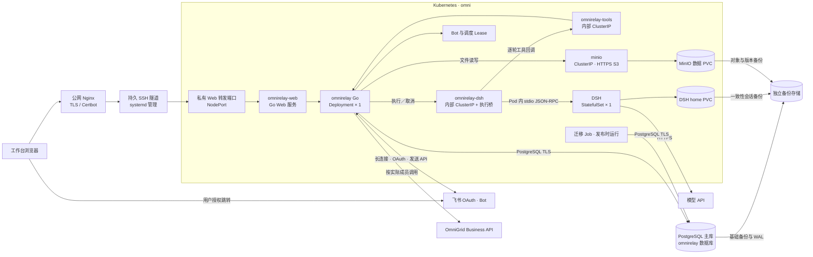

# OmniRelay Kubernetes 部署设计

2026-11-18 · v0.2

适用于首期 500 人以内、单飞书组织的部署。Go 与 DSH 各部署一个副本。PostgreSQL 保存 OmniRelay 运行数据和文件索引，MinIO 兼容的 S3 服务保存文件内容，OmniGrid Business API 保存正式项目和任务。生产优先接入公司已有 PostgreSQL，已有服务无法满足连接或备份要求时，再使用集群内 PostgreSQL Operator。模块与应用接口见 [Go 主服务详细设计](omni-relay-go-service-design.md)。

## 1. 资源与网络拓扑

资源名和端口是首期约定，可按目标集群规范替换。预发布和生产使用独立命名空间、飞书应用、回调地址、运行库及密钥引用。环境之间通过数据库、身份和网络规则隔离。

| 资源 | 用途与生命周期 |
| --- | --- |
| `Deployment/omnirelay` | 一个 Go Pod，持有工作台、OAuth、飞书长连接、组织同步、调度、执行 Worker 和发送 Worker。任务状态保存在 PostgreSQL，Pod 可替换 |
| `Service/omnirelay-web` | Go 的工作台和 OAuth 路由。目标主机的私有入口配置为该服务提供 NodePort，供现有 SSH 隧道转发 |
| `Service/omnirelay-tools` | ClusterIP，示例端口 9443。Go 的独立工具监听器，只向 DSH 桥开放 |
| `StatefulSet/omnirelay-dsh` | 一个 DSH Pod，运行执行桥和 DSH。执行桥管理本 Pod 内的子进程，通过管道交换 JSON-RPC |
| `Service/omnirelay-dsh` | ClusterIP，示例端口 9443。Go 通过私有 HTTPS 调用 |
| `Service/omnirelay-dsh-headless` | StatefulSet 的 Headless Service，设为 `.spec.serviceName`，用于 DSH Pod 稳定网络标识 |
| `StatefulSet/minio` 与 `Service/minio` | MinIO 兼容对象存储，单副本，独立 PVC，S3 通过集群内部 HTTPS 9000 访问。维护版本采用 [PGSTY Silo](https://github.com/pgsty/silo)，沿用 MinIO 的 S3 协议和环境变量 |
| DSH home PVC | 按环境配置存储类、容量、扩容和备份策略。CSI 支持时选用 `ReadWriteOncePod`，确保单 Pod 写入。卷上保存指定会话与运行状态。profile 与插件随镜像和配置发布 |
| `Job/omnirelay-migrate-<release>` | 每次发布按需运行，使用该版本镜像内的迁移命令和 SQL，迁移成功后推进发布 |
| `Lease/omnirelay-leader` | Go 实例竞争飞书长连接和定时触发权，覆盖滚动更新交接。授权收口到命名空间里的指定资源 |

工作台入口使用独立域名，例如 `relay.example.com`。公网 Nginx 终止 TLS，由 Certbot 续期和重载。持久 SSH 隧道通过 systemd 自动启动和重连，将流量送到集群的私有 Web NodePort。公网、SSH 和节点地址及端口由目标主机维护。启用密码登录时，Nginx 到 Go 的上游连接仍须使用并校验 HTTPS。OAuth 回调精确登记为 `/auth/feishu/callback` 的完整 HTTPS URL。Bot 使用 Go 出站连接飞书，生产入口只开放 Web 与登录面。内部 Service 经集群 DNS 发现，TLS 验证使用对应服务证书或集群工作负载身份。 [Kubernetes StatefulSet](https://kubernetes.io/docs/concepts/workloads/controllers/statefulset/) · [Kubernetes Lease](https://kubernetes.io/docs/concepts/architecture/leases/)

## 2. Go、DSH 和 PostgreSQL 的连接

### Go 与 DSH

- Go 访问 `omnirelay-dsh:9443`。执行桥的最小协议包括启动或取得既有 turn、按原编号读取状态、取消及返回流式结果。请求携带工作 ID、执行尝试 ID、会话引用、角色和截止时间。执行尝试 ID 由 Go 在调用前持久化，重连时先按原 ID 查状态。
- 桥接进程将请求转换为 DSH stdio JSON-RPC。DSH 工具调用经桥接发往 `omnirelay-tools:9443`。Go 验证桥接服务身份，并校验当前 turn、工作领取版本及短时授权。模型侧输入只包含业务工具参数。
- 桥接与 Go 的连接中断时，工作转入恢复流程。若桥接重启后无法确认原 turn，Go 先核查已登记的业务操作和交付，再决定是启动新的受限执行还是等待人工核对。Go 以 PostgreSQL 中的业务记录为准恢复状态。
- DSH 运行时获得模型凭据和会话卷。执行桥独占私有服务证书私钥和逐轮授权。首期启动器以独立 UID 运行 DSH 子进程，用管道连接，只传递许可的环境变量和文件描述符。工具回调由桥接进程绑定真实运行尝试。阶段零验证运行时无法读取桥接密钥、跨工作调用被拒绝，以及 DSH 退出后的取消与恢复。 [DSH stdio JSON-RPC 接口](https://github.com/deepseek-ai/deepseek-harness/blob/master/packages/sdk/server/README.md)

### Go 与 PostgreSQL

| 部署方式 | Go 与迁移 Job 的连接 | 运维归属 |
| --- | --- | --- |
| **公司或托管 PostgreSQL，默认** | 访问数据库提供方的私有读写地址，使用 TLS 校验证书与主机名。数据库名为 `omnirelay`，对象放在明确的应用 schema 下 | 数据库团队或托管平台负责主库切换、备份、WAL 归档和恢复；应用团队负责连接池、查询与 schema |
| **Kubernetes 内 PostgreSQL** | 建议由已有平台 Operator 管理。采用 CloudNativePG 时，Go 连接其 Cluster 的 `-rw` 服务，例如 `omnirelay-pg-rw:5432`，证书覆盖实际使用的服务名 | Operator 管理实例、PVC、主库路由和备份。按服务目标决定实例数和跨节点策略。生产备份送到独立对象存储 |

所有工作领取、幂等查询和应用写入走主库地址。首期使用 Go 连接池。按滚动发布期间同时运行的 Pod 数和迁移 Job 预留总连接配额，监控连接池等待和慢事务。数据库管理员创建应用库和固定的不可登录 schema 所有者角色。迁移身份切换到所有者角色执行 DDL。运行身份获得所需的 schema、表和序列权限，由所有者为后续创建的对象设定默认授权。连接凭据轮换时保留对象所有权。 [PostgreSQL TLS 与主机名校验](https://www.postgresql.org/docs/current/libpq-ssl.html) · [PostgreSQL 默认授权](https://www.postgresql.org/docs/current/sql-alterdefaultprivileges.html) · [CloudNativePG 读写服务](https://cloudnative-pg.io/docs/current/architecture/)

### Go 与 MinIO

- Go 使用 `minio.omni.svc:9000` 的 S3 HTTPS 接口，挂载部署生成的 CA 公钥并校验服务名。Go 通过按 bucket 授权的应用凭据读写私有 bucket。预留文件索引记录对象键、大小、类型、校验值和访问范围，访问由 Go 复核业务权限。
- 管理员凭据仅用于初始化 bucket、分配应用权限和维护。Go 及 DSH 使用各自的运行身份。浏览器与 DSH 的文件访问经过 Go，集群外入口只转发工作台和 OAuth。
- 初始数据卷为单节点本地卷，PVC 使用独立的 Retain 存储类。重建 Pod 可重挂同一卷。节点或磁盘故障需从独立对象备份恢复，应用和存储部署分别验收。

### 网络放行与滚动交接

| 发起侧 | 目标 |
| --- | --- |
| HTTPS 入口 | Go Web 端口 |
| Go Pod | DSH 桥、PostgreSQL、MinIO HTTPS、飞书 API／长连接、OmniGrid Business API、Kubernetes API（续租） |
| DSH Pod | Go 工具端口、批准的模型出口 |
| 迁移 Job | PostgreSQL |
| 备份组件 | 各自的数据／快照接口与备份存储 |

命名空间按需放通集群 DNS 和平台要求的探针流量。用支持 NetworkPolicy 的网络插件落实 Pod 级规则，外部域名白名单通过集群出口网关或平台提供的域名策略实现。Go 与 DSH 双向私有调用通过 mTLS 校验工作负载身份，工具入口同时校验应用级工作授权。使用自建证书时，CA 与服务证书由平台签发和轮换。 [Kubernetes NetworkPolicy](https://kubernetes.io/docs/concepts/services-networking/network-policies/)

Go 取得 Lease 后，按固定 Lease UID 和递增的选主交接版本在 PostgreSQL 登记单调递增的持有者编号，再开启 Bot 长连接和定时触发。登记拒绝过期交接版本。事件受理和定时入队在事务里验证当前持有者编号，替换后旧 Pod 的请求会被拒绝。旧实例失去租约或收到退出信号时关闭连接、停止触发并停止领取新工作。发送与业务写入继续使用各自的领取版本、唯一键和外部回执。验收覆盖 Kubernetes API 失联而 PostgreSQL 仍可用的情况。若重建 Lease，应先停旧实例并重建持有者记录。DSH 首期只运行一个挂载指定 home 的 Pod，更新前暂停新 turn 并等待或取消旧 turn。

Go 的启动探针检查配置加载，存活探针检查进程，就绪探针检查数据库、schema 和当前接流状态。DSH 临时不可用时，Go 仍可提供已授权的状态查询并按队列上限受理请求。DSH 桥的就绪探针核对运行时握手和会话卷可用，退出前停止接收新 turn 并执行有截止时间的排空。

## 3. 配置、密钥与归属

| 配置类别 | 归属与下发 | 变更方式 |
| --- | --- | --- |
| 公开模板与脚本 | Git 保存通用清单、占位示例和复现步骤。发布与构建在目标主机的 workspace 工程目录运行 | 发布记录关联代码版本和镜像标识 |
| 真实环境配置 | 目标主机工程目录的 `deploy/k8s/private/`。包含入口域名、SSH 和节点地址及端口、集群和存储覆盖配置 | 依据目标主机上的配置渲染或注入 K8s，目录从 Git 忽略 |
| 业务运行配置 | PostgreSQL。包括项目群绑定、简报时区与计划、组织同步设置、授权及可审计开关 | 有权管理员在系统里调整。带版本和审计，执行时读当前配置，暂停与撤权在发送前复核 |
| 应用与数据库密钥 | 公司密钥系统为首选来源，运行时注入 Pod。仅使用 Kubernetes Secret 时配置静态加密、限制读取权限，并保留受控恢复渠道 | 一类凭据单独轮换。记录密钥版本引用和更新时间，滚动更新对应组件，验证新凭据后撤销旧凭据 |
| 运行身份和证书 | Go、DSH 和迁移 Job 使用各自的 ServiceAccount，按需发放 API 权限和工作负载证书 | Go 仅获选主所需 API 权限。没有 Kubernetes API 调用的组件关闭自动挂载 ServiceAccount 令牌 |

按如下边界注入密钥：

- **Go Pod**取得飞书应用 OAuth／Bot 凭据、业务 API 服务身份、数据库运行身份以及 Go 的私有服务证书。
- **DSH Pod**内分开注入。执行桥持有私有接口证书及短时工作授权，DSH 运行时持有模型凭据和会话卷。
- **迁移 Job**取得迁移数据库身份和数据库 CA。发布流程在 Job 成功后记录结果并按集群策略回收 Job。
- **MinIO**由 Kubernetes Secret 注入管理员凭据和 S3 服务 TLS 私钥。Go 通过单独的应用 Secret 和 CA ConfigMap 访问私有 bucket。
- **备份组件**使用专用备份身份访问对象存储。恢复演练使用独立的恢复身份和地址。

飞书应用密钥、数据库凭据、证书私钥、用户 OAuth 令牌和回调授权码使用受控注入或进程内处理。日志、Git 和普通诊断输出仅记录脱敏标识。数据库轮换如需让新旧 Pod 短时共存，可先创建等权新登录身份，更新引用并滚动发布，确认旧连接池已排空后撤销旧身份。飞书密钥轮换需要按应用的实际换钥行为验证登录、目录读取和 Bot 重连。 [Kubernetes Secret 管理实践](https://kubernetes.io/docs/concepts/security/secrets-good-practices/)

## 4. 数据库迁移与发布

1. 应用镜像固定摘要，带同一版本的迁移文件。发布在测试环境用相同版本的 PostgreSQL 验证从上一版本升级、迁移重跑和旧程序继续运行。
2. 正式发布先提交经过审核的配置，再执行迁移 Job。Job 直连主库，在同一数据库连接上持有迁移锁，覆盖锁定、执行和记录整个过程。按版本记录校验值和执行结果。默认将可事务化的变更放在事务内。需要非事务执行的迁移单独登记失败恢复方法。DDL 设置锁等待时限，避免长期阻塞在线请求。
3. 迁移成功后滚动更新 Go。Go 在就绪时检查数据库可访问且 schema 位于本版本支持范围。迁移失败保留旧版本服务，发布停在迁移阶段，检查数据库记录和 Job 输出后续跑。
4. 字段变更遵循增加、兼容读写、后台回填、切换、退役的顺序。应用回滚优先回到兼容的旧镜像。删除字段或紧缩约束安排独立发布。大批回填有独立限速和检查点。
5. DSH 版本及 profile 单独发布。先在预发布确定协议兼容范围和会话格式。更新前暂停新工作进入 DSH，排空当前 turn，按需保存会话备份。变更跨 Go 和 DSH 时，先发布能兼容旧桥接接口的一侧。

迁移 Job 负责 schema。应用启动负责检查版本。备份恢复负责灾难场景。应用团队维护迁移与兼容矩阵，部署负责人执行发布，数据库负责人确认备份和恢复能力。

## 5. 备份与恢复

| 对象 | 备份方式 | 恢复核验 |
| --- | --- | --- |
| **PostgreSQL** | 基础备份加持续 WAL 归档，使用托管 PITR 或 Operator 提供的备份方案。备份存储与运行节点分别管理，按公司策略加密与保留 | 恢复到指定时间点。检查 schema、组织与账号、队列和交付记录。记录实际可恢复点及耗时 |
| **DSH 会话卷** | 在暂停新 turn、排空和确认会话落盘后做 PVC 快照或一致性文件备份。快照能力取决于目标存储类，跨故障域保留可恢复副本 | 校验 DSH 版本、profile 与会话引用。缺失或版本不匹配的会话按当前权限重建上下文 |
| **MinIO 对象** | 同步到独立存储或周期备份对象与版本，单独记录 bucket 策略和恢复点 | 在隔离环境按对象键与校验值读回，并对照 PostgreSQL 文件索引 |
| **部署配置与密钥** | Git 保存公共模板和镜像版本，真实环境配置由目标主机受控备份，密钥由公司密钥系统恢复或重新签发。备份记录关联发布版本、数据库恢复点和 DSH 备份时间 | 在恢复环境核对回调域名、角色、密钥引用、CA 和网络出口。演练环境使用测试应用与凭据 |

PostgreSQL 和 DSH 会话卷按各自的时间点恢复。运行账本保存在 PostgreSQL。会话内容缺失时，Go 先用原编号核对外部写入和发送，确认后从有权数据重建。建议首轮演练以运行账本 **RPO ≤ 1 小时、RTO ≤ 2 小时恢复受理**为目标，试点后按实测调整。记录 WAL 归档延迟、最近可恢复点、会话备份状态和最近恢复演练结果。 [PostgreSQL PITR](https://www.postgresql.org/docs/current/continuous-archiving.html) · [Kubernetes VolumeSnapshot](https://kubernetes.io/docs/concepts/storage/volume-snapshots/) · [CloudNativePG 对象存储备份](https://cloudnative-pg.io/plugin-barman-cloud/docs/concepts/)

### 恢复顺序

1. 在隔离命名空间恢复 PostgreSQL 到新实例或恢复端点，重挂 DSH 会话卷。演练环境从启动起限制生产集成出口，关闭生产 Bot 消费、自动写入和外发，注入测试通道凭据。
2. 核对应用 schema、账号、项目群绑定、日简报键以及历史回执。重新核验账号停用和权限撤销，失效恢复出的浏览器会话及工作授权。启动 Go 与 DSH 的恢复验证，缺少有效会话的工作按当前权限重建。
3. 正式切换前确保旧环境停止生产 Bot 消费和自动任务。对恢复点到故障之间的任务与发送逐项使用原操作编号和回执核对。无法确认的记录保持待核对。
4. 先恢复只读查询和状态验证，再恢复明确写入，最后开启定时发布。记录恢复点、尚需人工处理的记录和实际恢复耗时。

## 6. 上线验收

- MinIO 的 S3 就绪探针通过。验收写入、读回、匿名拒绝和重建 Pod 后读回，确认对外入口只转发 Web。
- Go 访问 PostgreSQL 主库、MinIO、DSH 私有桥和 OmniGrid。工作台能完成飞书登录，飞书群 @ 能从新 Bot 进入并回复原话题。
- 工具回调从 DSH 到 Go 工作正常。外部访问、错误工作负载身份、过期 turn 授权和其他工作的授权按预期拒绝。
- Go 滚动更新时验证 Lease 交接和事件重投去重。DSH Pod 重建后验证卷恢复及并发中断。PostgreSQL 暂时不可用时验证入站确认逻辑、连接恢复和原操作对账。
- 在临时环境验证迁移 Job 失败与重跑、旧程序兼容，以及运行账号对新增表和序列的访问。演练 PostgreSQL 时间点恢复和 DSH 会话卷恢复，记录可恢复点、恢复耗时和未结回执。
- 上线前冻结入口域名与证书、Kubernetes 网络插件和 StorageClass、PostgreSQL 提供方式、备份位置、DSH 执行桥协议和组件版本。

本稿给出部署拓扑和操作契约。生产资源配额、数据库版本、存储类、恢复目标和备份保留期以目标集群与试点验收确定。
