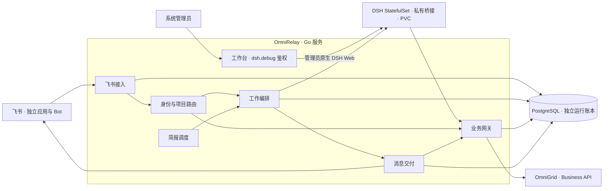

# OmniRelay 模块设计

2026-11-18 · v0.3 架构评审稿

OmniRelay 是飞书里的项目协作 Agent。首期承接群内 @、私聊、项目查询、同项目任务分派、任务重要性标记和每日群简报。普通项目成员可以查询本项目共享任务，也可以直接给同项目成员分派新任务。每日简报集中发布重点，逐人催办留在首期范围之外。

部署从全新环境开始。OmniRelay 使用 Go，独立部署 DSH 和飞书 Bot。以下模块按 **OmniGrid 继续持有正式项目、成员和任务** 的设计前提编排。项目中涉及的 `Business API` 是给新环境定义的契约，由正式业务系统实现。若正式任务的归属另有安排，需要确定该契约的实现方。

## 1. 服务部署边界

首期在 Kubernetes 部署 OmniRelay Go 服务和专用 DSH，另接 PostgreSQL 与正式业务服务。Go 服务内划分接入与交付、工作编排、业务访问三个模块组。各组通过 Go 接口协作，共用 PostgreSQL 运行账本。

资源拓扑、网络、密钥、迁移和备份见 [OmniRelay Kubernetes 部署设计](omni-relay-k8s-deployment-design.md)。

| 部署单元 | 职责 | 数据与凭据 |
| --- | --- | --- |
| **OmniRelay Go 服务** | Kubernetes Deployment。首期一个副本，承载 Bot、工作台、调度和执行 Worker | 飞书应用凭据、业务 API 服务身份、PostgreSQL 运行库凭据。工作台通过 HTTPS 入口访问 |
| **OmniRelay 专用 DSH** | 独立 StatefulSet，首期一个副本。提供查询、分派和分析执行 | 独立 PVC 挂载 DSH home，单独持有模型凭据。通过 Go 的受限工具访问当前工作允许的数据 |
| **dshbot 管理入口** | 系统管理员从工作台进入生产 DSH 的管理界面。项目 Bot 与管理入口使用同一套 Runtime、模型配置和原生会话记录 | 模型凭据由 Runtime 持有。Go 校验登录会话和 `dsh.debug`，管理员可跨项目操作，工作台登录失效或权限撤销时断开连接 |
| **PostgreSQL** | OmniRelay 运行账本，保存入站事件、队列、账号角色、组织目录、配置、审计和回执 | 独立数据库，区分迁移与运行账号。优先使用托管或公司标准 PostgreSQL，若在集群内运行则由数据库 Operator 管理 |
| **正式业务服务** | 校验成员权限与任务规则，提交正式任务和重要性标记 | 项目、成员、正式任务、业务审计和写入回执。如果由 OmniGrid 承担，部署为独立业务依赖 |

跨 Pod 采用私有服务通信。Go 通过 `AgentRunner` 调用 DSH Pod 内的桥接端，桥接端在本 Pod 内用 stdio JSON-RPC 驱动 DSH。工具回调通过独立的 Go 内部入口，使用服务身份和逐轮授权校验。桥接协议与 DSH 兼容性在阶段零验证。飞书、业务和运行库凭据仅挂载给有对应职责的组件。

Go Pod 在滚动更新期间可能重叠，飞书长连接与定时触发由持有 Kubernetes Lease 的副本运行，失去租约即停止接收和触发。PostgreSQL 的唯一约束、领取版本和外部幂等编号继续保证并发与重试时的业务一致性。 [Kubernetes Lease](https://kubernetes.io/docs/concepts/architecture/leases/) · [Kubernetes StatefulSet](https://kubernetes.io/docs/concepts/workloads/controllers/statefulset/)

### 服务故障与拆分条件

- **DSH 暂时不可用。** Go 仍可持久化新事件并查询工作状态，执行队列按上限和等待期限收敛。DSH 恢复后继续处理可恢复工作，已有写入先按原操作编号对账。
- **飞书发送暂时不可用。** 已取得的任务结果与待发消息分别保存。交付模块按原目标和编号对账，回复送达状态独立显示。
- **业务系统暂时不可用。** 已受理工作保留状态，写入结果未知时等业务回执复核。只读查询明确返回当前不可取得数据。
- **需要独立扩容时。** 若 Agent 积压持续超过目标，先核对排队时间、入口响应时延和 DSH 并发。优先把与 DSH 通信的执行 Worker 拆成独立 Deployment，继续通过 PostgreSQL 领取任务。Bot 长连接与定时触发由入口服务的选主副本持有，消息出站由 Go 交付模块领取。

### 模块关系

**dshbot 管理入口。** 系统管理员通过工作台进入原生 DSH Web，拥有原生 owner 操作权限。Web 和项目 SDK 运行在同一个生产 Runtime Pod，读取同一模型 Secret 和 Agent 会话目录。两个 Host 通过 DSH 原生写锁串行修改会话。Web 侧维护自己的界面偏好和工作区列表。

## 2. 模块职责

Go 包结构、接口签名、工作台接口与调用时序见 [Go 主服务详细设计](omni-relay-go-service-design.md)。飞书登录、用户角色、组织架构与通讯录同步、系统配置和审计同属 Go 主服务，见该文的「系统功能与权限」。

| Go 包 | 职责 | 唯一负责的数据与契约 |
| --- | --- | --- |
| `feishu` | 接入长连接，解析群 @、私聊、发送者、消息和话题，包装发送与回复 API | 平台报文与内部事件的转换。入口接收、发送适配共享 SDK，发送操作只由消息交付调用 |
| `routing` | 将飞书用户映射到业务成员，解析项目与话题关联，识别歧义 | 群／话题的项目绑定、目标群绑定、确定的请求上下文。项目成员关系从业务系统读取 |
| `orchestrator` | 消费事件、创建工作、选择 DSH 角色、串行化同一对话的执行、分派交付 | 工作状态、排队顺序、重试、会话关联和执行预算。使用存储事务同时保存工作结果和交付意图 |
| `agent/dsh` | 管理 DSH 连接，将工作映射到会话，归一化流式结果、取消和错误 | `AgentRunner` 实现、profile 配置、会话引用和协议兼容。会话正文由 DSH 持久化 |
| `business` | 校验受限工具调用、项目成员和公开范围，适配正式业务 API | 工具白名单、有效工作授权、读字段投影、操作编号及真实业务回执的本地关联 |
| `briefing` | 根据项目时区计算日简报触发，生成检查任务，支持预览和指定群发布 | 简报计划、项目本地日期和作业唯一键。分析通过工作编排进入 DSH |
| `delivery` | 生成可发送消息、确认实际目标、发送前复核、记录飞书结果 | 交付意图、目标快照、飞书消息 ID、未知投递的对账状态 |
| `store/postgres` | 管理迁移、事务、唯一约束、领取及到期恢复 | PostgreSQL 存储实现。每张记录的状态变更由对应业务模块决定 |

配置加载、日志、指标、运行检查从 `cmd/omnirelay` 集中装配。首期可通过受控配置维护群绑定和简报计划。入站模块通过工作编排提交事件，DSH 适配器只实现执行契约，交付模块只通过飞书适配器投递。HTTP／Unix socket、DSH 协议帧和飞书 SDK 类型停留在各自的适配模块。仅当 DSH 接入需要原生工具桥时新增 TypeScript 包，业务规则集中在 Go 服务。界面与 Bot 卡片模板随功能需要逐步加入。

### DSH 角色与工具

| 角色 | 输入与输出 | 可用业务工具 |
| --- | --- | --- |
| 查询 | 共享任务和项目状态 → 带依据的结果或澄清 | 读取项目概览、分页查询共享任务 |
| 任务分派 | 用户明确交办 → 澄清或真实创建回执 | 查项目成员、创建并分派新任务、查原操作结果 |
| 项目分析 | 指定项目和群可见范围 → 重要性建议、重点简报 | 获取有范围的项目快照、提交有依据的自动标记候选。由 Go 核验和提交正式变更 |

Go 按事件范围、用户请求和操作策略分配工作。群或项目不明确时先做澄清。对话里的讨论性表述、转发正文、模型建议以及简报中的建议均不构成任务分派授权。首个写入版本只支持来源清晰的明确交办。负责人重名或目标项目不确定时，补齐信息后仍按后续消息的真实发起人校验。

DSH 结果使用短小的结构化契约，例如 `answer`、`clarify`、`operation_result`、`briefing`，携带必要的来源或回执引用。Go 验证结构、引用和当前工作匹配，再渲染飞书回复。只有业务回执确认提交后才表述为“已创建并分派”。

部署时使用显式受限 profile，并核对真实挂载的工具。DSH 运行账户不持有飞书凭据、直接业务凭据或 Go 运行数据库访问权。工具入口用 Go 绑定的短时工作授权定位角色、项目、当前发起人和策略版本。每次调用校验授权的有效期、操作、字段和对象。一个 DSH 会话内若无法可靠传递逐轮授权，首期在隔离执行上下文中处理每次工作，连续对话只传经过范围校验的必要上下文。独立 home 用于隔离配置和会话文件，执行权限还要靠运行身份和文件／网络边界约束。官方 `sdk-minimal` 文档列有 Shell 工具和会话日志上传配置，首期逐项核对工具与数据出站配置。 [DSH SDK profile 文档](https://deepseek-harness.github.io/deepseek-harness/en/guide/python-sdk)

## 3. 核心契约与权限

### 工作上下文

`WorkContext` 由 Go 生成，包括 `work_id`、`project_id`、可信业务成员 ID 或定时服务身份、来源应用、群／私聊、话题／消息引用、可发布范围、策略版本和截止时间。模型只提交工具业务参数，例如任务标题和负责人候选编号。身份、项目、目标群和工作授权由 Go 注入，并随调用复核。

群里读取的数据须同时满足成员可见、项目共享和群可公开三个条件。单项目群按已核验的群绑定路由，多项目群按可信话题或明确项目引用路由。私聊按发起人的项目权限读取，存在多个候选时先确认项目。独立的定时服务身份只获得指定项目和目标群所需的分析范围。回复前检查原请求人和目标范围是否仍有效。群里其他成员的追问使用新发起人校验，连续对话仅延续当前成员仍可见的内容。

会话关联使用应用／组织、项目、群或私聊、话题、角色、发起成员和访问范围版本。首期群会话也按发起人隔离。其他成员可接续已经公开的内容和经授权的业务引用，由 Go 重新读取当前成员可见的资料。成员、群范围或策略收窄时停止复用旧会话，重新从当前有权来源构造上下文。执行中的工作在后续工具调用和发送前同样复核。

### 正式业务接口

| 契约 | 输入和结果 |
| --- | --- |
| 身份与项目 | 受信平台标识 → 稳定业务成员；返回当前成员关系、项目身份及版本。群绑定支持明确配置，歧义交给用户补充 |
| 共享查询 | 可信成员、项目、群公开范围、过滤条件、分页 → 有权字段、稳定对象 ID、数据版本和来源引用 |
| 创建并分派 | 可信成员、项目、负责人、获准字段、稳定 `operation_id` → 正式任务、提交状态与回执。业务系统在写入时复核成员与对象 |
| 原操作查询 | `operation_id` → 成功、失败、进行中或未知；返回正式对象或拒绝原因。相同编号和冻结参数用于安全重投 |
| 分析与标记 | 项目快照、来源版本、对象版本和原因 → 有版本的重要性变更。人工选择与自动证据分别保存 |
| 公开范围 | 目标群、关联项目、来源及版本 → 当前可公开信息的判定，支持发布前复核 |

业务系统须能把服务调用绑定到可信发起人或限权定时身份。接口传输和认证方案在阶段零落实。阶段一依赖真实接口，可将新 Bot 收到的发送者标识映射到业务成员，并实时校验读权限与群公开范围。阶段二要求业务端以项目和原操作编号原子去重，同一编号的参数变更应被拒绝。查询工具首先返回最小任务视图，附加资料只开放明确共享的来源。自动标记候选可以从分析阶段生成。人工强制重要／排除的具体优先规则在开启标记写入前确认。

## 4. 工作与发送的持久化

| 记录 | 关键标识与状态 |
| --- | --- |
| `inbox_events` | 消息入口以应用、组织及原始消息 ID 去重。记录平台事件 ID、来源和接收时间。允许的事件先落库，再确认接收 |
| `work_items` | 工作 ID、来源、会话顺序、角色、截止时间；排队、运行、等待澄清、等待对账、完成或失败 |
| `session_bindings` | 对话和角色对应 DSH 会话、范围版本、可复用状态 |
| `business_operations` | 按工作及操作用途分配的稳定操作编号、冻结的规范化参数或受控引用、正式对象与回执。状态为准备、执行中、成功、明确失败或未知 |
| `deliveries` | 稳定交付编号、目标和冻结内容、飞书消息 ID；待发、发送中、已发送、明确失败或未知 |
| `briefing_runs` | 项目、项目本地日期、目标群和计划版本。项目、日期、目标群唯一；计划更新仍指向原有日简报 |

接收消息与建立待处理记录在同一事务完成。Worker 领取有有效期的工作，使用领取版本避免过期实例提交结果。同一对话的工作有序执行，等待用户补充时释放执行配额。跨对话的同一对象写入由正式业务接口解决并发和版本冲突。模型调用和外部 IO 在 PostgreSQL 事务之外执行。队列大小、执行并发、单次超时和每日模型预算均为显式配置。工作取消后撤销后续工具调用权限，已经提交的操作继续按原编号对账。

业务写入和飞书发送分别持久化操作意图，再执行外部调用。业务调用超时或进程重启后，用原 `operation_id` 查询是否已提交。只有确认可安全重投时才按冻结目标和参数复用原编号。任务提交成功而飞书确认未知时，保留正式任务回执，单独进入发送对账。

飞书发送按指定目标区分“回复原消息”和“发布简报”。在目标端点支持并经实测后，将稳定交付编号映射到平台幂等字段。应验证回复、发送、目标已撤回、超时及平台去重时效，避免 SDK 自动改成群内新消息或隐藏重试影响回执。未获得飞书消息 ID 且无法可靠核实时保留 `unknown` 并等待人工核对。明确拒绝与结果未知分开处理。 [飞书 Go SDK 发送与自动回退](https://github.com/larksuite/oapi-sdk-go/blob/v3_main/doc/channel.md) · [发送 API](https://open.feishu.cn/document/server-docs/im-v1/message/create) · [回复 API](https://open.feishu.cn/document/server-docs/im-v1/message/reply)

## 5. 三条主链路

1. **查项目。** Go 接收一条群 @ 或私聊，锁定真实成员和项目。DSH 查询角色通过网关获取获准数据，生成带来源的文本。Go 复核并回复原消息。同一入站消息对应一条最终交付。
2. **创建并分派任务。** DSH 提取标题、负责人、期限等字段，Go 核对明确交办、当前成员和目标范围。写入前固定业务操作编号，拿到正式任务编号后回复。重复事件或超时恢复沿用同一操作。
3. **每日重点简报。** Go 以项目时区触发，用项目、日期和目标群认领一次作业。分析角色根据共享快照提出重要事项，之后保存预览。开启发布的项目在发送前再次确认信息来源和公开范围。补跑窗口、是否包含休息日和发送时段按项目配置。重复触发复用原作业。

## 6. 交付顺序与验收

| 阶段 | 交付 | 通过标准 |
| --- | --- | --- |
| 0 · 兼容验证 | 在测试命名空间与测试群，用模拟 Business API 跑通 Go、DSH、新 Bot 和 PostgreSQL | 跨 Pod 执行、续用和取消。验证工具白名单、逐轮授权及跨工作隔离、原消息回复、重复事件、滚动更新和重启对账。锁定 DSH、SDK、PostgreSQL 和 Go 驱动兼容版本 |
| 1 · 只读试点 | 一个项目的群 @ 与私聊查询 | 普通成员能查共享任务。跨项目字段在模型输入前过滤。同一消息只交付一次，群范围变更后废止旧上下文 |
| 2 · 任务写入 | 明确请求创建并分派 | 同项目普通成员可直接分派。负责人同名时消歧，业务端按真实发起人执行，超时后能按编号找回唯一正式任务 |
| 3 · 每日简报 | 自动标记、人工纠正、预览和配置后发布 | 验证日期切换、停机恢复、范围撤销、已发送与未知状态。同一项目和目标群每天至多一次常规发布 |

每个阶段用同一组关联标识追踪 `event_id → work_id → dsh_session_id → operation_id / delivery_id`。记录队列深度、最老工作年龄、处理时延、权限拒绝和未结回执。日志仅保留必要元数据，原始聊天和消息内容使用受控存储及明确的保留周期。正式开启自动发布前确定首个试点项目、目标群、时区、发送计划和预算。当前交付为模块设计，目标环境与业务 API 兼容性在阶段零验证。
